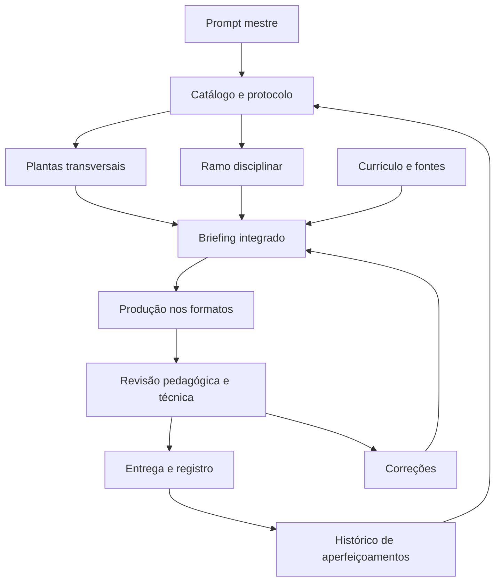

# Arquitetura de organização e composição das bibliotecas
Versão: 1.0.0 — 28/10/2026. Especificação documental de navegação e produção, sem novo serviço de IA instalado.

## Âncora — o problema que a estrutura resolve
O prompt concentra regras, mas não deve depender de lembranças da conversa para ser executado. Cada ideia precisa de definição, operação, exemplo, limite e critério de verificação. O catálogo conecta essas unidades e distingue documentação, proposta e implementação.

## Mecânica — camadas e responsabilidades
| Camada | Conteúdo | Responsabilidade |
| --- | --- | --- |
| Entrada | Prompt mestre e AGENTS | Requisitos e ordem de consulta |
| Organização | Catálogo e protocolo desta biblioteca | Selecionar recursos e suas dependências |
| Pedagogia | Plantas transversais e disciplinares | Explicar como construir e mediar a experiência |
| Evidência | Catálogo curricular e fontes do conteúdo | Sustentar conceitos, recortes e habilidades |
| Produção | Biblioteca de Diagramação, lock e fluxo de slides | Converter conteúdo em formatos e testar funcionamento |
| Entregas e evolução | Materiais, catálogo de publicação e histórico | Registrar o que foi produzido, conferido, publicado ou aplicado |

Bibliotecas especializadas podem crescer sob esses contratos, sem criar outra fonte concorrente para a mesma regra. Livros aprofundam formulações e preservam sua filiação; não substituem silenciosamente a especificação vigente de produção.

## Circuito — conexões

Dependências indicam leituras e contratos; não obrigam uma tela para cada arquitetura. A mesma unidade pode realizar várias funções. A integração depende de uma relação clara, não da quantidade de siglas visíveis.

## Contrato entre bibliotecas
Cada biblioteca conectada informa identidade, caminho, versão ou revisão, finalidade, disponibilidade e fonte de autoridade. O catálogo usa caminhos relativos à raiz. Plantas possuem IDs estáveis e dependências sem ciclos de leitura. Conexões conceituais podem ser recíprocas no texto, sem obrigar ciclos de carregamento.

Uma biblioteca técnica privada é referenciada pelo lock e ponte pública existente; seu código ou credenciais não são copiados. Quando não houver acesso, informar a limitação e usar apenas alternativas autorizadas e verificadas.

## Dialética — conflitos e continuidade
Para decisões pedagógicas do projeto, observar a instrução atual explícita do professor, o prompt vigente e as plantas compatíveis. Essa ordem não altera instruções da plataforma ou permissões de acesso. Modelo antigo é referência; pendência não é diretriz ativa. Se houver contradição, registrar a divergência, preservar filiação e corrigir a fonte pertinente.

AEE e SVS possuem convenções históricas diferentes; consultar PENDENCIAS.md. Não misturar automaticamente os códigos. Não presumir que a IA leu um arquivo por ter recebido um link.

## Evolução controlada
Uma nova ideia percorre: registrar origem e estado → delimitar objetivo → preencher planta → identificar relações → desenvolver exemplo e contraexemplo → revisar → cadastrar → atualizar prompt/histórico quando houver nova regra. Implementação e aplicação são estados distintos, que exigem evidência própria.

Separar três dimensões: maturidade da formulação, implementação técnica e evidência de aprendizagem. Um arquivo pode estar completo e o artefato ainda não construído. Um artefato funcionando pode não ter sido usado em aula.
