# Direitos em movimento — Frases opcionais

**3ª série · História**

[Voltar ao apoio](apoio-leitura.md)

Escolha este caminho depois da primeira fase. Observe as pessoas, os objetos e os lugares; peça leitura das opções quando precisar. Há 96 atividades retomáveis.

## Conjunto 1

### 1. Qual frase combina com a cena?

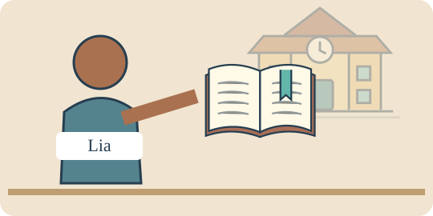

Observe quem aparece, o objeto e o lugar.

- Lia mostra o mapa.
- Bia mostra o livro.
- Lia mostra o livro.

Minha resposta: __________________

### 2. Qual frase combina com a cena?

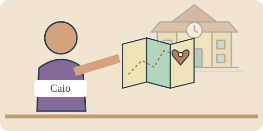

Observe quem aparece, o objeto e o lugar.

- Davi mostra o mapa.
- Caio mostra o mapa.
- Caio mostra o jornal.

Minha resposta: __________________

### 3. Qual frase combina com a cena?

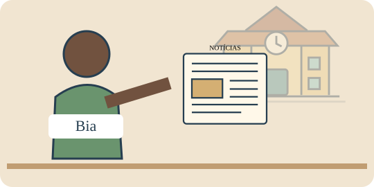

Observe quem aparece, o objeto e o lugar.

- Bia mostra o jornal.
- Bia mostra a carta.
- Iara mostra o jornal.

Minha resposta: __________________

### 4. Qual frase combina com a cena?

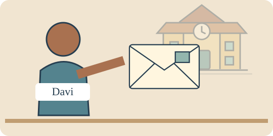

Observe quem aparece, o objeto e o lugar.

- Davi mostra o documento.
- Léo mostra a carta.
- Davi mostra a carta.

Minha resposta: __________________

### 5. Qual frase combina com a cena?

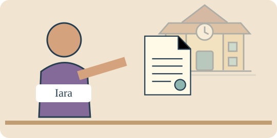

Observe quem aparece, o objeto e o lugar.

- Ana mostra o documento.
- Iara mostra o documento.
- Iara mostra a escola.

Minha resposta: __________________

### 6. Qual frase combina com a cena?

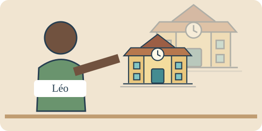

Observe quem aparece, o objeto e o lugar.

- Léo mostra a escola.
- Léo mostra o grupo.
- Ravi mostra a escola.

Minha resposta: __________________

### 7. Qual frase combina com a cena?

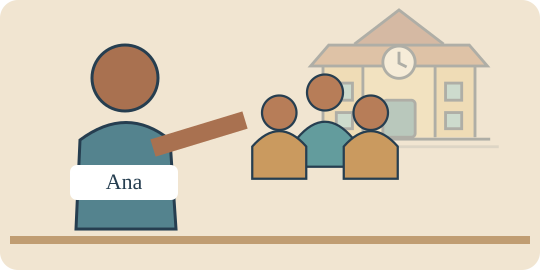

Observe quem aparece, o objeto e o lugar.

- Ana mostra a praça.
- Eva mostra o grupo.
- Ana mostra o grupo.

Minha resposta: __________________

### 8. Qual frase combina com a cena?

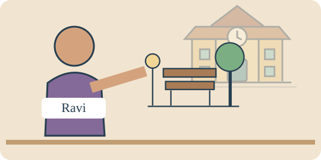

Observe quem aparece, o objeto e o lugar.

- Noa mostra a praça.
- Ravi mostra a praça.
- Ravi mostra a rua.

Minha resposta: __________________

### 9. Qual frase combina com a cena?

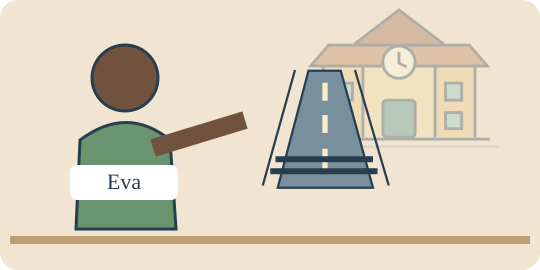

Observe quem aparece, o objeto e o lugar.

- Eva mostra a rua.
- Eva mostra a porta.
- Luz mostra a rua.

Minha resposta: __________________

### 10. Qual frase combina com a cena?

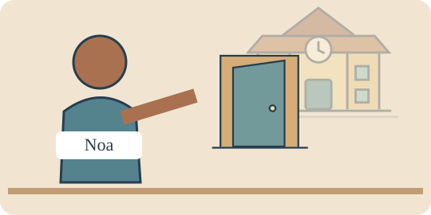

Observe quem aparece, o objeto e o lugar.

- Noa mostra a bandeira.
- Luísa mostra a porta.
- Noa mostra a porta.

Minha resposta: __________________

### 11. Qual frase combina com a cena?

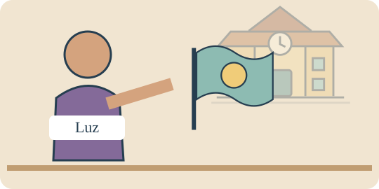

Observe quem aparece, o objeto e o lugar.

- Lia mostra a bandeira.
- Luz mostra a bandeira.
- Luz mostra a pessoa.

Minha resposta: __________________

### 12. Qual frase combina com a cena?

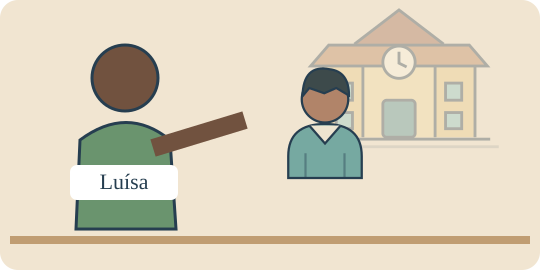

Observe quem aparece, o objeto e o lugar.

- Luísa mostra a pessoa.
- Luísa mostra o livro.
- Caio mostra a pessoa.

Minha resposta: __________________

## Conjunto 2

### 13. Junte duas palavras para começar a frase.

Observe quem aparece, o objeto e o lugar.

- mostra.
- Lia

Minha resposta: __________________

### 14. Junte duas palavras para começar a frase.

Observe quem aparece, o objeto e o lugar.

- Caio
- mostra.

Minha resposta: __________________

### 15. Junte duas palavras para começar a frase.

Observe quem aparece, o objeto e o lugar.

- mostra.
- Bia

Minha resposta: __________________

### 16. Junte duas palavras para começar a frase.

Observe quem aparece, o objeto e o lugar.

- Davi
- mostra.

Minha resposta: __________________

### 17. Junte duas palavras para começar a frase.

Observe quem aparece, o objeto e o lugar.

- mostra.
- Iara

Minha resposta: __________________

### 18. Junte duas palavras para começar a frase.

Observe quem aparece, o objeto e o lugar.

- Léo
- mostra.

Minha resposta: __________________

### 19. Junte duas palavras para começar a frase.

Observe quem aparece, o objeto e o lugar.

- mostra.
- Ana

Minha resposta: __________________

### 20. Junte duas palavras para começar a frase.

Observe quem aparece, o objeto e o lugar.

- Ravi
- mostra.

Minha resposta: __________________

### 21. Junte duas palavras para começar a frase.

Observe quem aparece, o objeto e o lugar.

- mostra.
- Eva

Minha resposta: __________________

### 22. Junte duas palavras para começar a frase.

Observe quem aparece, o objeto e o lugar.

- Noa
- mostra.

Minha resposta: __________________

### 23. Junte duas palavras para começar a frase.

Observe quem aparece, o objeto e o lugar.

- mostra.
- Luz

Minha resposta: __________________

### 24. Junte duas palavras para começar a frase.

Observe quem aparece, o objeto e o lugar.

- Luísa
- mostra.

Minha resposta: __________________

## Conjunto 3

### 25. Quem mostra o objeto?

Observe quem aparece, o objeto e o lugar.

- Caio
- Bia
- Lia

Minha resposta: __________________

### 26. Quem mostra o objeto?

Observe quem aparece, o objeto e o lugar.

- Davi
- Caio
- Bia

Minha resposta: __________________

### 27. Quem mostra o objeto?

Observe quem aparece, o objeto e o lugar.

- Bia
- Davi
- Iara

Minha resposta: __________________

### 28. Quem mostra o objeto?

Observe quem aparece, o objeto e o lugar.

- Iara
- Léo
- Davi

Minha resposta: __________________

### 29. Quem mostra o objeto?

Observe quem aparece, o objeto e o lugar.

- Ana
- Iara
- Léo

Minha resposta: __________________

### 30. Quem mostra o objeto?

Observe quem aparece, o objeto e o lugar.

- Léo
- Ana
- Ravi

Minha resposta: __________________

### 31. Quem mostra o objeto?

Observe quem aparece, o objeto e o lugar.

- Ravi
- Eva
- Ana

Minha resposta: __________________

### 32. Quem mostra o objeto?

Observe quem aparece, o objeto e o lugar.

- Noa
- Ravi
- Eva

Minha resposta: __________________

### 33. Quem mostra o objeto?

Observe quem aparece, o objeto e o lugar.

- Eva
- Noa
- Luz

Minha resposta: __________________

### 34. Quem mostra o objeto?

Observe quem aparece, o objeto e o lugar.

- Luz
- Luísa
- Noa

Minha resposta: __________________

### 35. Quem mostra o objeto?

Observe quem aparece, o objeto e o lugar.

- Lia
- Luz
- Luísa

Minha resposta: __________________

### 36. Quem mostra o objeto?

Observe quem aparece, o objeto e o lugar.

- Luísa
- Lia
- Caio

Minha resposta: __________________

## Conjunto 4

### 37. O que completa a frase?

Lia mostra ___.

- o mapa
- um objeto que não aparece
- o livro

Minha resposta: __________________

### 38. O que completa a frase?

Caio mostra ___.

- um objeto que não aparece
- o mapa
- o jornal

Minha resposta: __________________

### 39. O que completa a frase?

Bia mostra ___.

- o jornal
- a carta
- um objeto que não aparece

Minha resposta: __________________

### 40. O que completa a frase?

Davi mostra ___.

- o documento
- um objeto que não aparece
- a carta

Minha resposta: __________________

### 41. O que completa a frase?

Iara mostra ___.

- um objeto que não aparece
- o documento
- a escola

Minha resposta: __________________

### 42. O que completa a frase?

Léo mostra ___.

- a escola
- o grupo
- um objeto que não aparece

Minha resposta: __________________

### 43. O que completa a frase?

Ana mostra ___.

- a praça
- um objeto que não aparece
- o grupo

Minha resposta: __________________

### 44. O que completa a frase?

Ravi mostra ___.

- um objeto que não aparece
- a praça
- a rua

Minha resposta: __________________

### 45. O que completa a frase?

Eva mostra ___.

- a rua
- a porta
- um objeto que não aparece

Minha resposta: __________________

### 46. O que completa a frase?

Noa mostra ___.

- a bandeira
- um objeto que não aparece
- a porta

Minha resposta: __________________

### 47. O que completa a frase?

Luz mostra ___.

- um objeto que não aparece
- a bandeira
- a pessoa

Minha resposta: __________________

### 48. O que completa a frase?

Luísa mostra ___.

- a pessoa
- o livro
- um objeto que não aparece

Minha resposta: __________________

## Conjunto 5

### 49. Monte a frase completa.

Observe quem aparece, o objeto e o lugar.

- mostra
- o livro.
- Lia

Minha resposta: __________________

### 50. Monte a frase completa.

Observe quem aparece, o objeto e o lugar.

- o mapa.
- Caio
- mostra

Minha resposta: __________________

### 51. Monte a frase completa.

Observe quem aparece, o objeto e o lugar.

- Bia
- mostra
- o jornal.

Minha resposta: __________________

### 52. Monte a frase completa.

Observe quem aparece, o objeto e o lugar.

- mostra
- a carta.
- Davi

Minha resposta: __________________

### 53. Monte a frase completa.

Observe quem aparece, o objeto e o lugar.

- o documento.
- Iara
- mostra

Minha resposta: __________________

### 54. Monte a frase completa.

Observe quem aparece, o objeto e o lugar.

- Léo
- mostra
- a escola.

Minha resposta: __________________

### 55. Monte a frase completa.

Observe quem aparece, o objeto e o lugar.

- mostra
- o grupo.
- Ana

Minha resposta: __________________

### 56. Monte a frase completa.

Observe quem aparece, o objeto e o lugar.

- a praça.
- Ravi
- mostra

Minha resposta: __________________

### 57. Monte a frase completa.

Observe quem aparece, o objeto e o lugar.

- Eva
- mostra
- a rua.

Minha resposta: __________________

### 58. Monte a frase completa.

Observe quem aparece, o objeto e o lugar.

- mostra
- a porta.
- Noa

Minha resposta: __________________

### 59. Monte a frase completa.

Observe quem aparece, o objeto e o lugar.

- a bandeira.
- Luz
- mostra

Minha resposta: __________________

### 60. Monte a frase completa.

Observe quem aparece, o objeto e o lugar.

- Luísa
- mostra
- a pessoa.

Minha resposta: __________________

## Conjunto 6

### 61. Qual frase acrescenta o lugar da cena?

Observe quem aparece, o objeto e o lugar.

- Lia mostra o livro na rua.
- Lia mostra o livro na ponte.
- Lia mostra o livro na escola.

Minha resposta: __________________

### 62. Qual frase acrescenta o lugar da cena?

Observe quem aparece, o objeto e o lugar.

- Caio mostra o mapa na ponte.
- Caio mostra o mapa na escola.
- Caio mostra o mapa na rua.

Minha resposta: __________________

### 63. Qual frase acrescenta o lugar da cena?

Observe quem aparece, o objeto e o lugar.

- Bia mostra o jornal na escola.
- Bia mostra o jornal na rua.
- Bia mostra o jornal na ponte.

Minha resposta: __________________

### 64. Qual frase acrescenta o lugar da cena?

Observe quem aparece, o objeto e o lugar.

- Davi mostra a carta na rua.
- Davi mostra a carta na ponte.
- Davi mostra a carta na escola.

Minha resposta: __________________

### 65. Qual frase acrescenta o lugar da cena?

Observe quem aparece, o objeto e o lugar.

- Iara mostra o documento na ponte.
- Iara mostra o documento na escola.
- Iara mostra o documento na rua.

Minha resposta: __________________

### 66. Qual frase acrescenta o lugar da cena?

Observe quem aparece, o objeto e o lugar.

- Léo mostra a escola na escola.
- Léo mostra a escola na rua.
- Léo mostra a escola na ponte.

Minha resposta: __________________

### 67. Qual frase acrescenta o lugar da cena?

Observe quem aparece, o objeto e o lugar.

- Ana mostra o grupo na rua.
- Ana mostra o grupo na ponte.
- Ana mostra o grupo na escola.

Minha resposta: __________________

### 68. Qual frase acrescenta o lugar da cena?

Observe quem aparece, o objeto e o lugar.

- Ravi mostra a praça na ponte.
- Ravi mostra a praça na escola.
- Ravi mostra a praça na rua.

Minha resposta: __________________

### 69. Qual frase acrescenta o lugar da cena?

Observe quem aparece, o objeto e o lugar.

- Eva mostra a rua na escola.
- Eva mostra a rua na rua.
- Eva mostra a rua na ponte.

Minha resposta: __________________

### 70. Qual frase acrescenta o lugar da cena?

Observe quem aparece, o objeto e o lugar.

- Noa mostra a porta na rua.
- Noa mostra a porta na ponte.
- Noa mostra a porta na escola.

Minha resposta: __________________

### 71. Qual frase acrescenta o lugar da cena?

Observe quem aparece, o objeto e o lugar.

- Luz mostra a bandeira na ponte.
- Luz mostra a bandeira na escola.
- Luz mostra a bandeira na rua.

Minha resposta: __________________

### 72. Qual frase acrescenta o lugar da cena?

Observe quem aparece, o objeto e o lugar.

- Luísa mostra a pessoa na escola.
- Luísa mostra a pessoa na rua.
- Luísa mostra a pessoa na ponte.

Minha resposta: __________________

## Conjunto 7

### 73. Qual frase conta as imagens na ordem?

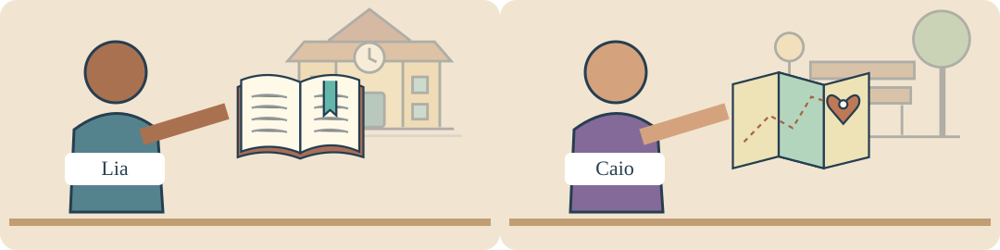

Observe quem aparece, o objeto e o lugar.

- Caio mostra o mapa. Depois, Lia mostra o livro.
- As duas imagens mostram a mesma pessoa com o mesmo objeto.
- Lia mostra o livro. Depois, Caio mostra o mapa.

Minha resposta: __________________

### 74. Qual frase conta as imagens na ordem?

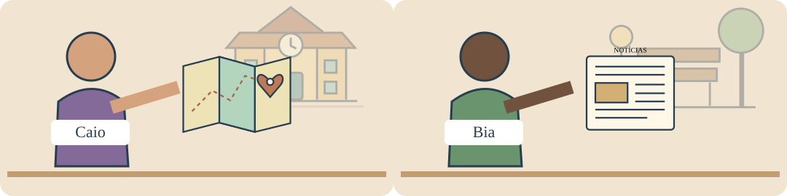

Observe quem aparece, o objeto e o lugar.

- As duas imagens mostram a mesma pessoa com o mesmo objeto.
- Caio mostra o mapa. Depois, Bia mostra o jornal.
- Bia mostra o jornal. Depois, Caio mostra o mapa.

Minha resposta: __________________

### 75. Qual frase conta as imagens na ordem?

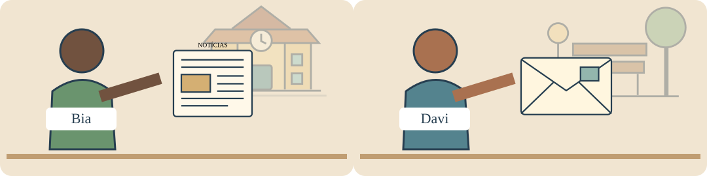

Observe quem aparece, o objeto e o lugar.

- Bia mostra o jornal. Depois, Davi mostra a carta.
- Davi mostra a carta. Depois, Bia mostra o jornal.
- As duas imagens mostram a mesma pessoa com o mesmo objeto.

Minha resposta: __________________

### 76. Qual frase conta as imagens na ordem?

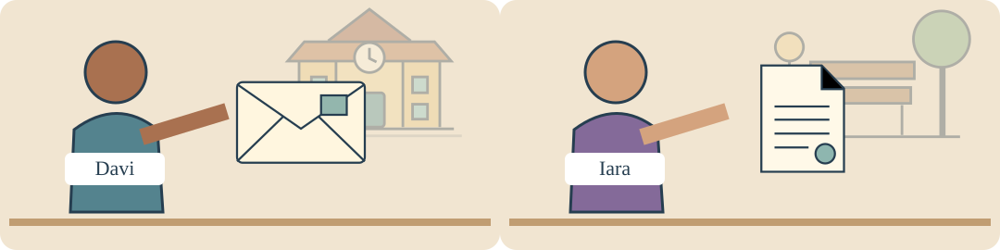

Observe quem aparece, o objeto e o lugar.

- Iara mostra o documento. Depois, Davi mostra a carta.
- As duas imagens mostram a mesma pessoa com o mesmo objeto.
- Davi mostra a carta. Depois, Iara mostra o documento.

Minha resposta: __________________

### 77. Qual frase conta as imagens na ordem?

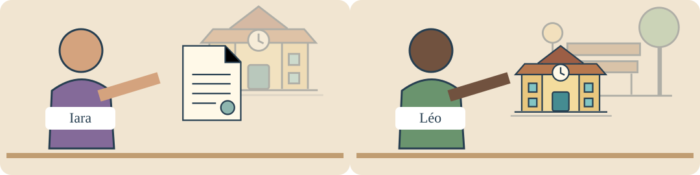

Observe quem aparece, o objeto e o lugar.

- As duas imagens mostram a mesma pessoa com o mesmo objeto.
- Iara mostra o documento. Depois, Léo mostra a escola.
- Léo mostra a escola. Depois, Iara mostra o documento.

Minha resposta: __________________

### 78. Qual frase conta as imagens na ordem?

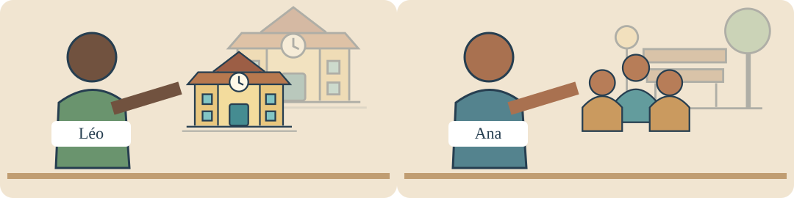

Observe quem aparece, o objeto e o lugar.

- Léo mostra a escola. Depois, Ana mostra o grupo.
- Ana mostra o grupo. Depois, Léo mostra a escola.
- As duas imagens mostram a mesma pessoa com o mesmo objeto.

Minha resposta: __________________

### 79. Qual frase conta as imagens na ordem?

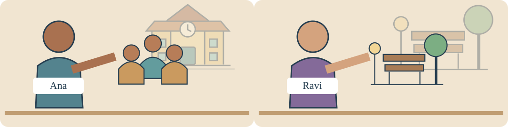

Observe quem aparece, o objeto e o lugar.

- Ravi mostra a praça. Depois, Ana mostra o grupo.
- As duas imagens mostram a mesma pessoa com o mesmo objeto.
- Ana mostra o grupo. Depois, Ravi mostra a praça.

Minha resposta: __________________

### 80. Qual frase conta as imagens na ordem?

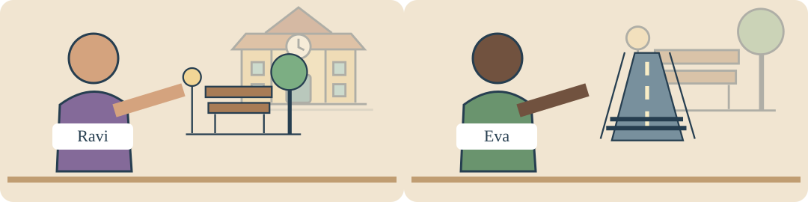

Observe quem aparece, o objeto e o lugar.

- As duas imagens mostram a mesma pessoa com o mesmo objeto.
- Ravi mostra a praça. Depois, Eva mostra a rua.
- Eva mostra a rua. Depois, Ravi mostra a praça.

Minha resposta: __________________

### 81. Qual frase conta as imagens na ordem?

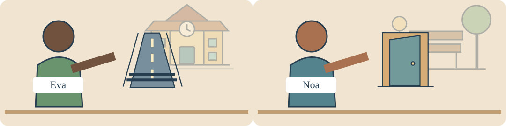

Observe quem aparece, o objeto e o lugar.

- Eva mostra a rua. Depois, Noa mostra a porta.
- Noa mostra a porta. Depois, Eva mostra a rua.
- As duas imagens mostram a mesma pessoa com o mesmo objeto.

Minha resposta: __________________

### 82. Qual frase conta as imagens na ordem?

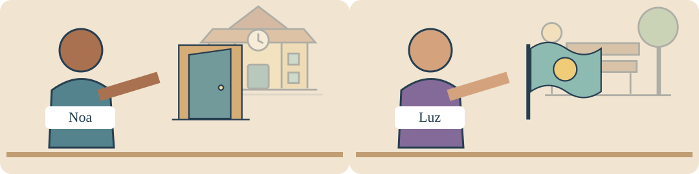

Observe quem aparece, o objeto e o lugar.

- Luz mostra a bandeira. Depois, Noa mostra a porta.
- As duas imagens mostram a mesma pessoa com o mesmo objeto.
- Noa mostra a porta. Depois, Luz mostra a bandeira.

Minha resposta: __________________

### 83. Qual frase conta as imagens na ordem?

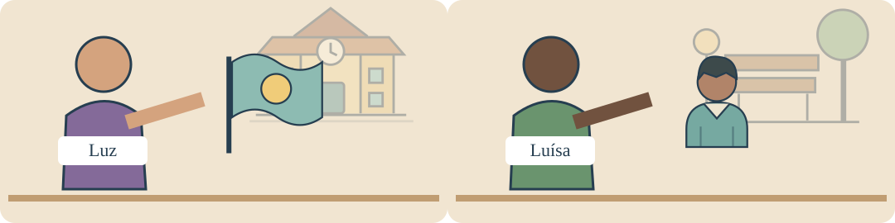

Observe quem aparece, o objeto e o lugar.

- As duas imagens mostram a mesma pessoa com o mesmo objeto.
- Luz mostra a bandeira. Depois, Luísa mostra a pessoa.
- Luísa mostra a pessoa. Depois, Luz mostra a bandeira.

Minha resposta: __________________

### 84. Qual frase conta as imagens na ordem?

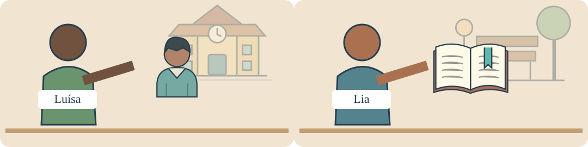

Observe quem aparece, o objeto e o lugar.

- Luísa mostra a pessoa. Depois, Lia mostra o livro.
- Lia mostra o livro. Depois, Luísa mostra a pessoa.
- As duas imagens mostram a mesma pessoa com o mesmo objeto.

Minha resposta: __________________

## Conjunto 8

### 85. Qual frase combina com a cena?

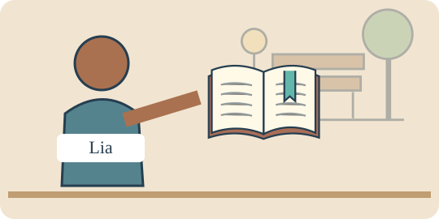

Observe quem aparece, o objeto e o lugar.

- Lia mostra o mapa.
- Bia mostra o livro.
- Lia mostra o livro.

Minha resposta: __________________

### 86. Qual frase combina com a cena?

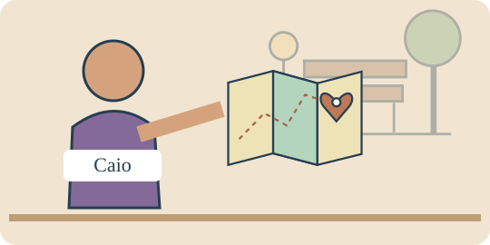

Observe quem aparece, o objeto e o lugar.

- Davi mostra o mapa.
- Caio mostra o mapa.
- Caio mostra o jornal.

Minha resposta: __________________

### 87. Qual frase combina com a cena?

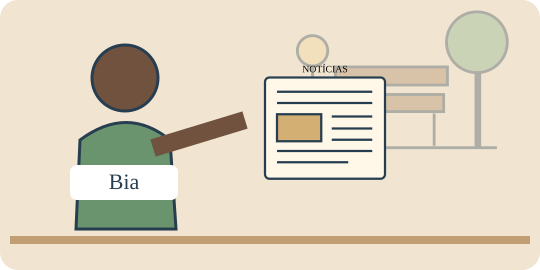

Observe quem aparece, o objeto e o lugar.

- Bia mostra o jornal.
- Bia mostra a carta.
- Iara mostra o jornal.

Minha resposta: __________________

### 88. Qual frase combina com a cena?

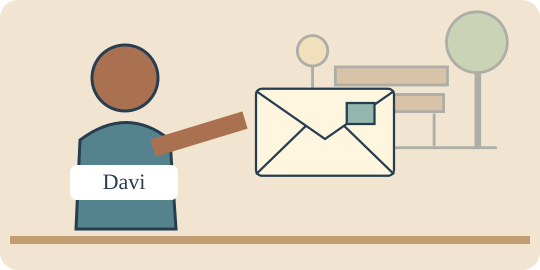

Observe quem aparece, o objeto e o lugar.

- Davi mostra o documento.
- Léo mostra a carta.
- Davi mostra a carta.

Minha resposta: __________________

### 89. Qual frase combina com a cena?

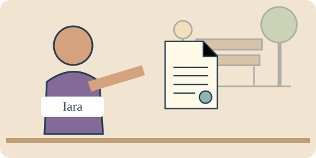

Observe quem aparece, o objeto e o lugar.

- Ana mostra o documento.
- Iara mostra o documento.
- Iara mostra a escola.

Minha resposta: __________________

### 90. Qual frase combina com a cena?

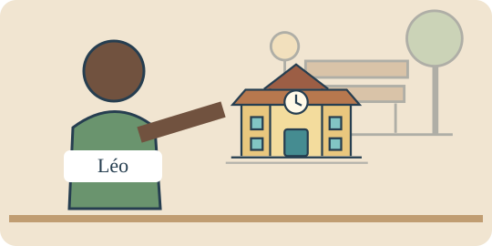

Observe quem aparece, o objeto e o lugar.

- Léo mostra a escola.
- Léo mostra o grupo.
- Ravi mostra a escola.

Minha resposta: __________________

### 91. Qual frase combina com a cena?

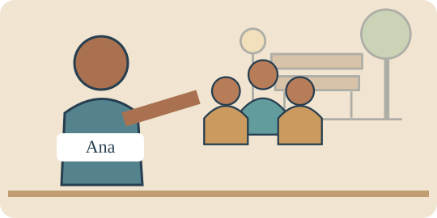

Observe quem aparece, o objeto e o lugar.

- Ana mostra a praça.
- Eva mostra o grupo.
- Ana mostra o grupo.

Minha resposta: __________________

### 92. Qual frase combina com a cena?

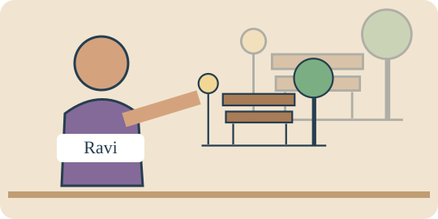

Observe quem aparece, o objeto e o lugar.

- Noa mostra a praça.
- Ravi mostra a praça.
- Ravi mostra a rua.

Minha resposta: __________________

### 93. Qual frase combina com a cena?

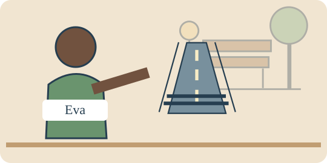

Observe quem aparece, o objeto e o lugar.

- Eva mostra a rua.
- Eva mostra a porta.
- Luz mostra a rua.

Minha resposta: __________________

### 94. Qual frase combina com a cena?

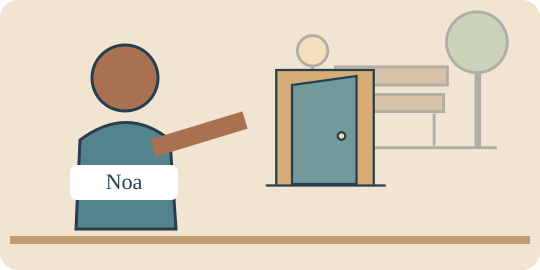

Observe quem aparece, o objeto e o lugar.

- Noa mostra a bandeira.
- Luísa mostra a porta.
- Noa mostra a porta.

Minha resposta: __________________

### 95. Qual frase combina com a cena?

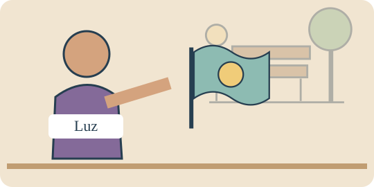

Observe quem aparece, o objeto e o lugar.

- Lia mostra a bandeira.
- Luz mostra a bandeira.
- Luz mostra a pessoa.

Minha resposta: __________________

### 96. Qual frase combina com a cena?

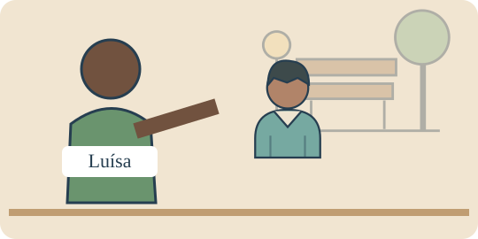

Observe quem aparece, o objeto e o lugar.

- Luísa mostra a pessoa.
- Luísa mostra o livro.
- Caio mostra a pessoa.

Minha resposta: __________________

