# Saberes que seguem vivos — Imagens, letras, palavras e frases

**9º ano · Eletiva de Base**

[Voltar à aula](aula.md)

Aponte, fale, escolha ou monte os cartões com mediação. Faça uma relação por vez. Você pode parar e retomar. As primeiras 48 atividades trabalham letras; depois são 24 de palavras e 24 de frases.

## Conjunto 1 — Letras

### 1. Qual é a primeira letra do nome desta imagem?

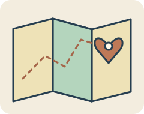

**Exemplo com outro caso:** Outro exemplo: ARTE começa com A. undefined

Escolhas: **F** · **S** · **M**

Minha resposta: __________________

### 2. Qual é a primeira letra do nome desta imagem?

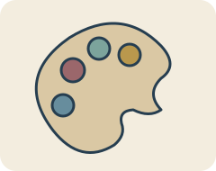

Escolhas: **S** · **A** · **F**

Minha resposta: __________________

### 3. Qual é a primeira letra do nome desta imagem?

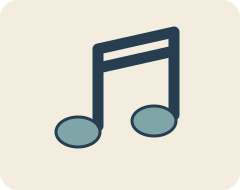

Escolhas: **M** · **F** · **S**

Minha resposta: __________________

### 4. Qual é a primeira letra do nome desta imagem?

Escolhas: **F** · **S** · **G**

Minha resposta: __________________

### 5. Qual é a primeira letra do nome desta imagem?

Escolhas: **S** · **P** · **F**

Minha resposta: __________________

### 6. Qual é a primeira letra do nome desta imagem?

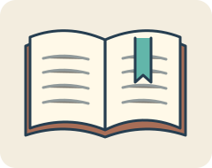

Escolhas: **L** · **F** · **S**

Minha resposta: __________________

### 7. Qual é a primeira letra do nome desta imagem?

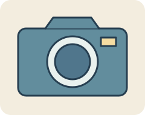

Escolhas: **L** · **S** · **F**

Minha resposta: __________________

### 8. Qual é a primeira letra do nome desta imagem?

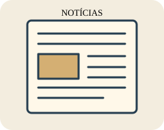

Escolhas: **S** · **J** · **F**

Minha resposta: __________________

### 9. Qual é a primeira letra do nome desta imagem?

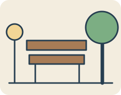

Escolhas: **P** · **F** · **S**

Minha resposta: __________________

### 10. Qual é a primeira letra do nome desta imagem?

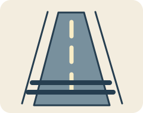

Escolhas: **F** · **S** · **R**

Minha resposta: __________________

### 11. Qual é a primeira letra do nome desta imagem?

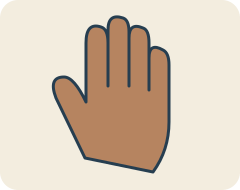

Escolhas: **S** · **M** · **F**

Minha resposta: __________________

### 12. Qual é a primeira letra do nome desta imagem?

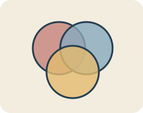

Escolhas: **C** · **F** · **S**

Minha resposta: __________________

## Conjunto 2 — Letras

### 13. Qual imagem tem nome que começa com esta letra?

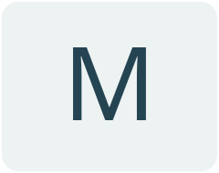

Escolhas: **ARTE** · **GRUPO** · **MAPA**

Minha resposta: __________________

### 14. Qual imagem tem nome que começa com esta letra?

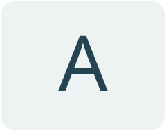

Escolhas: **MÚSICA** · **ARTE** · **MAPA**

Minha resposta: __________________

### 15. Qual imagem tem nome que começa com esta letra?

Escolhas: **MÚSICA** · **ARTE** · **GRUPO**

Minha resposta: __________________

### 16. Qual imagem tem nome que começa com esta letra?

Escolhas: **MAPA** · **ARTE** · **GRUPO**

Minha resposta: __________________

### 17. Qual imagem tem nome que começa com esta letra?

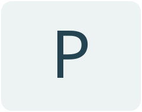

Escolhas: **ARTE** · **PESSOA** · **MAPA**

Minha resposta: __________________

### 18. Qual imagem tem nome que começa com esta letra?

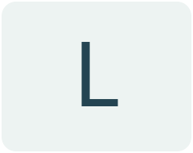

Escolhas: **LIVRO** · **MAPA** · **ARTE**

Minha resposta: __________________

### 19. Qual imagem tem nome que começa com esta letra?

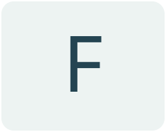

Escolhas: **MAPA** · **ARTE** · **FOTO**

Minha resposta: __________________

### 20. Qual imagem tem nome que começa com esta letra?

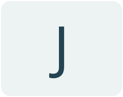

Escolhas: **ARTE** · **JORNAL** · **MAPA**

Minha resposta: __________________

### 21. Qual imagem tem nome que começa com esta letra?

Escolhas: **PRAÇA** · **MAPA** · **ARTE**

Minha resposta: __________________

### 22. Qual imagem tem nome que começa com esta letra?

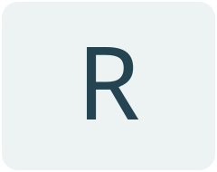

Escolhas: **MAPA** · **ARTE** · **RUA**

Minha resposta: __________________

### 23. Qual imagem tem nome que começa com esta letra?

Escolhas: **GRUPO** · **MÃO** · **ARTE**

Minha resposta: __________________

### 24. Qual imagem tem nome que começa com esta letra?

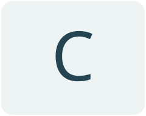

Escolhas: **COR** · **MAPA** · **ARTE**

Minha resposta: __________________

## Conjunto 3 — Letras

### 25. Qual letra maiúscula corresponde à que aparece?

Escolhas: **R** · **V** · **A**

Minha resposta: __________________

### 26. Qual letra maiúscula corresponde à que aparece?

Escolhas: **V** · **B** · **R**

Minha resposta: __________________

### 27. Qual letra maiúscula corresponde à que aparece?

Escolhas: **C** · **R** · **V**

Minha resposta: __________________

### 28. Qual letra maiúscula corresponde à que aparece?

Escolhas: **R** · **V** · **D**

Minha resposta: __________________

### 29. Qual letra maiúscula corresponde à que aparece?

Escolhas: **V** · **E** · **R**

Minha resposta: __________________

### 30. Qual letra maiúscula corresponde à que aparece?

Escolhas: **F** · **R** · **V**

Minha resposta: __________________

### 31. Qual letra maiúscula corresponde à que aparece?

Escolhas: **R** · **V** · **G**

Minha resposta: __________________

### 32. Qual letra maiúscula corresponde à que aparece?

Escolhas: **V** · **H** · **R**

Minha resposta: __________________

### 33. Qual letra maiúscula corresponde à que aparece?

Escolhas: **I** · **R** · **V**

Minha resposta: __________________

### 34. Qual letra maiúscula corresponde à que aparece?

Escolhas: **R** · **V** · **J**

Minha resposta: __________________

### 35. Qual letra maiúscula corresponde à que aparece?

Escolhas: **V** · **L** · **R**

Minha resposta: __________________

### 36. Qual letra maiúscula corresponde à que aparece?

Escolhas: **M** · **R** · **V**

Minha resposta: __________________

## Conjunto 4 — Letras

### 37. Qual letra completa o começo da palavra da imagem?

**_ APA**

Escolhas: **B** · **D** · **M**

Minha resposta: __________________

### 38. Qual letra completa o começo da palavra da imagem?

**_ RTE**

Escolhas: **D** · **A** · **B**

Minha resposta: __________________

### 39. Qual letra completa o começo da palavra da imagem?

**_ ÚSICA**

Escolhas: **M** · **B** · **D**

Minha resposta: __________________

### 40. Qual letra completa o começo da palavra da imagem?

**_ RUPO**

Escolhas: **B** · **D** · **G**

Minha resposta: __________________

### 41. Qual letra completa o começo da palavra da imagem?

**_ ESSOA**

Escolhas: **D** · **P** · **B**

Minha resposta: __________________

### 42. Qual letra completa o começo da palavra da imagem?

**_ IVRO**

Escolhas: **L** · **B** · **D**

Minha resposta: __________________

### 43. Qual letra completa o começo da palavra da imagem?

**_ OTO**

Escolhas: **B** · **D** · **F**

Minha resposta: __________________

### 44. Qual letra completa o começo da palavra da imagem?

**_ ORNAL**

Escolhas: **D** · **J** · **B**

Minha resposta: __________________

### 45. Qual letra completa o começo da palavra da imagem?

**_ RAÇA**

Escolhas: **P** · **B** · **D**

Minha resposta: __________________

### 46. Qual letra completa o começo da palavra da imagem?

**_ UA**

Escolhas: **B** · **D** · **R**

Minha resposta: __________________

### 47. Qual letra completa o começo da palavra da imagem?

**_ ÃO**

Escolhas: **D** · **M** · **B**

Minha resposta: __________________

### 48. Qual letra completa o começo da palavra da imagem?

**_ OR**

Escolhas: **C** · **B** · **D**

Minha resposta: __________________

## Conjunto 5 — Palavras

### 49. Qual palavra é o nome desta imagem?

**Exemplo com outro caso:** Nesta outra imagem, lemos ARTE. undefined

Escolhas: **ARTE** · **MÚSICA** · **MAPA**

Minha resposta: __________________

### 50. Qual palavra é o nome desta imagem?

Escolhas: **GRUPO** · **ARTE** · **MÚSICA**

Minha resposta: __________________

### 51. Qual palavra é o nome desta imagem?

Escolhas: **MÚSICA** · **GRUPO** · **PESSOA**

Minha resposta: __________________

### 52. Qual palavra é o nome desta imagem?

Escolhas: **PESSOA** · **LIVRO** · **GRUPO**

Minha resposta: __________________

### 53. Qual palavra é o nome desta imagem?

Escolhas: **FOTO** · **PESSOA** · **LIVRO**

Minha resposta: __________________

### 54. Qual palavra é o nome desta imagem?

Escolhas: **LIVRO** · **FOTO** · **JORNAL**

Minha resposta: __________________

### 55. Qual palavra é o nome desta imagem?

Escolhas: **JORNAL** · **PRAÇA** · **FOTO**

Minha resposta: __________________

### 56. Qual palavra é o nome desta imagem?

Escolhas: **RUA** · **JORNAL** · **PRAÇA**

Minha resposta: __________________

### 57. Qual palavra é o nome desta imagem?

Escolhas: **PRAÇA** · **RUA** · **MÃO**

Minha resposta: __________________

### 58. Qual palavra é o nome desta imagem?

Escolhas: **MÃO** · **COR** · **RUA**

Minha resposta: __________________

### 59. Qual palavra é o nome desta imagem?

Escolhas: **MAPA** · **MÃO** · **COR**

Minha resposta: __________________

### 60. Qual palavra é o nome desta imagem?

Escolhas: **COR** · **MAPA** · **ARTE**

Minha resposta: __________________

## Conjunto 6 — Palavras

### 61. Junte as letras para escrever o nome da imagem.

Cartões para organizar: **A** · **P** · **A** · **M**

Minha resposta: __________________

### 62. Junte as letras para escrever o nome da imagem.

Cartões para organizar: **T** · **E** · **A** · **R**

Minha resposta: __________________

### 63. Junte as letras para escrever o nome da imagem.

Cartões para organizar: **I** · **C** · **A** · **M** · **Ú** · **S**

Minha resposta: __________________

### 64. Junte as letras para escrever o nome da imagem.

Cartões para organizar: **O** · **G** · **R** · **U** · **P**

Minha resposta: __________________

### 65. Junte as letras para escrever o nome da imagem.

Cartões para organizar: **A** · **P** · **E** · **S** · **S** · **O**

Minha resposta: __________________

### 66. Junte as letras para escrever o nome da imagem.

Cartões para organizar: **I** · **V** · **R** · **O** · **L**

Minha resposta: __________________

### 67. Junte as letras para escrever o nome da imagem.

Cartões para organizar: **O** · **F** · **O** · **T**

Minha resposta: __________________

### 68. Junte as letras para escrever o nome da imagem.

Cartões para organizar: **R** · **N** · **A** · **L** · **J** · **O**

Minha resposta: __________________

### 69. Junte as letras para escrever o nome da imagem.

Cartões para organizar: **A** · **P** · **R** · **A** · **Ç**

Minha resposta: __________________

### 70. Junte as letras para escrever o nome da imagem.

Cartões para organizar: **U** · **A** · **R**

Minha resposta: __________________

### 71. Junte as letras para escrever o nome da imagem.

Cartões para organizar: **O** · **M** · **Ã**

Minha resposta: __________________

### 72. Junte as letras para escrever o nome da imagem.

Cartões para organizar: **C** · **O** · **R**

Minha resposta: __________________

## Conjunto 7 — Frases

### 73. Qual frase conta o que aparece?

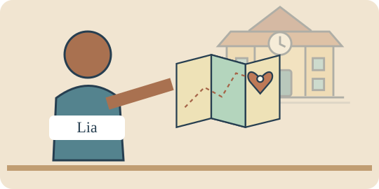

**Exemplo com outro caso:** Caio mostra a arte.

Escolhas: **Lia mostra a arte.** · **Caio mostra o mapa.** · **Lia mostra o mapa.**

Minha resposta: __________________

### 74. Qual frase conta o que aparece?

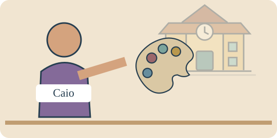

Escolhas: **Bia mostra a arte.** · **Caio mostra a arte.** · **Caio mostra a música.**

Minha resposta: __________________

### 75. Qual frase conta o que aparece?

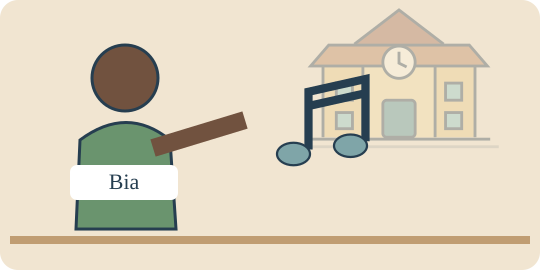

Escolhas: **Bia mostra a música.** · **Bia mostra o grupo.** · **Davi mostra a música.**

Minha resposta: __________________

### 76. Qual frase conta o que aparece?

Escolhas: **Davi mostra a pessoa.** · **Iara mostra o grupo.** · **Davi mostra o grupo.**

Minha resposta: __________________

### 77. Qual frase conta o que aparece?

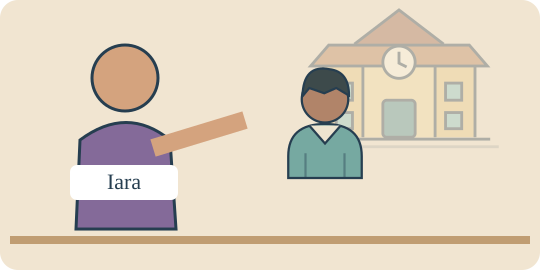

Escolhas: **Léo mostra a pessoa.** · **Iara mostra a pessoa.** · **Iara mostra o livro.**

Minha resposta: __________________

### 78. Qual frase conta o que aparece?

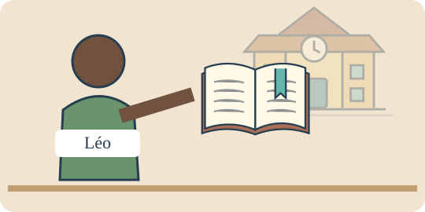

Escolhas: **Léo mostra o livro.** · **Léo mostra a foto.** · **Ana mostra o livro.**

Minha resposta: __________________

### 79. Qual frase conta o que aparece?

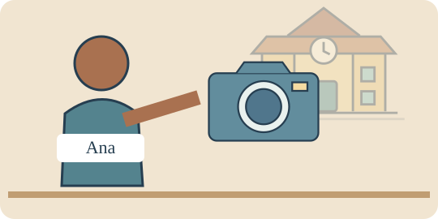

Escolhas: **Ana mostra o jornal.** · **Ravi mostra a foto.** · **Ana mostra a foto.**

Minha resposta: __________________

### 80. Qual frase conta o que aparece?

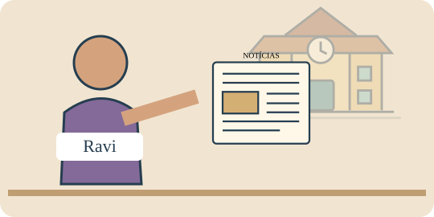

Escolhas: **Eva mostra o jornal.** · **Ravi mostra o jornal.** · **Ravi mostra a praça.**

Minha resposta: __________________

### 81. Qual frase conta o que aparece?

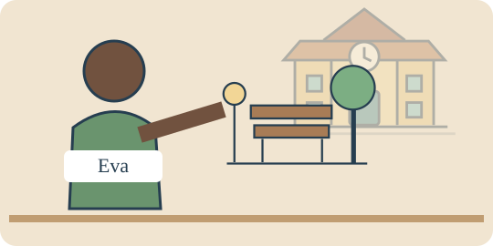

Escolhas: **Eva mostra a praça.** · **Eva mostra a rua.** · **Noa mostra a praça.**

Minha resposta: __________________

### 82. Qual frase conta o que aparece?

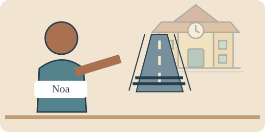

Escolhas: **Noa mostra a mão.** · **Luz mostra a rua.** · **Noa mostra a rua.**

Minha resposta: __________________

### 83. Qual frase conta o que aparece?

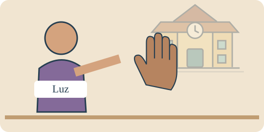

Escolhas: **Luísa mostra a mão.** · **Luz mostra a mão.** · **Luz mostra a cor.**

Minha resposta: __________________

### 84. Qual frase conta o que aparece?

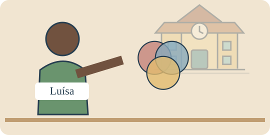

Escolhas: **Luísa mostra a cor.** · **Luísa mostra o mapa.** · **Lia mostra a cor.**

Minha resposta: __________________

## Conjunto 8 — Frases

### 85. Junte os cartões para contar a cena.

Cartões para organizar: **mostra** · **o mapa.** · **Lia**

Minha resposta: __________________

### 86. Junte os cartões para contar a cena.

Cartões para organizar: **a arte.** · **Caio** · **mostra**

Minha resposta: __________________

### 87. Junte os cartões para contar a cena.

Cartões para organizar: **Bia** · **mostra** · **a música.**

Minha resposta: __________________

### 88. Junte os cartões para contar a cena.

Cartões para organizar: **mostra** · **o grupo.** · **Davi**

Minha resposta: __________________

### 89. Junte os cartões para contar a cena.

Cartões para organizar: **a pessoa.** · **Iara** · **mostra**

Minha resposta: __________________

### 90. Junte os cartões para contar a cena.

Cartões para organizar: **Léo** · **mostra** · **o livro.**

Minha resposta: __________________

### 91. Junte os cartões para contar a cena.

Cartões para organizar: **mostra** · **a foto.** · **Ana**

Minha resposta: __________________

### 92. Junte os cartões para contar a cena.

Cartões para organizar: **o jornal.** · **Ravi** · **mostra**

Minha resposta: __________________

### 93. Junte os cartões para contar a cena.

Cartões para organizar: **Eva** · **mostra** · **a praça.**

Minha resposta: __________________

### 94. Junte os cartões para contar a cena.

Cartões para organizar: **mostra** · **a rua.** · **Noa**

Minha resposta: __________________

### 95. Junte os cartões para contar a cena.

Cartões para organizar: **a mão.** · **Luz** · **mostra**

Minha resposta: __________________

### 96. Junte os cartões para contar a cena.

Cartões para organizar: **Luísa** · **mostra** · **a cor.**

Minha resposta: __________________

## Depois das 96 atividades

Você pode encerrar por hoje ou escolher a [fase opcional de frases](frases-opcionais.md). Ela tem registros separados e não altera a avaliação do caminho principal.
