# Saberes que seguem vivos — Frases opcionais

**9º ano · Eletiva de Base**

[Voltar ao apoio](apoio-leitura.md)

Escolha este caminho depois da primeira fase. Observe as pessoas, os objetos e os lugares; peça leitura das opções quando precisar. Há 96 atividades retomáveis.

## Conjunto 1

### 1. Qual frase combina com a cena?

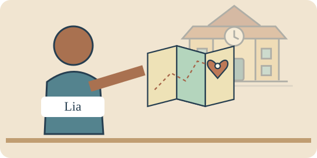

Observe quem aparece, o objeto e o lugar.

- Lia mostra a arte.
- Bia mostra o mapa.
- Lia mostra o mapa.

Minha resposta: __________________

### 2. Qual frase combina com a cena?

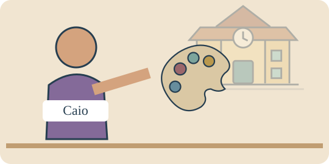

Observe quem aparece, o objeto e o lugar.

- Davi mostra a arte.
- Caio mostra a arte.
- Caio mostra a música.

Minha resposta: __________________

### 3. Qual frase combina com a cena?

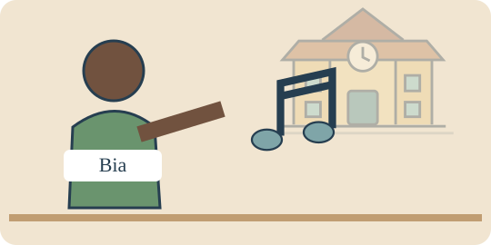

Observe quem aparece, o objeto e o lugar.

- Bia mostra a música.
- Bia mostra o grupo.
- Iara mostra a música.

Minha resposta: __________________

### 4. Qual frase combina com a cena?

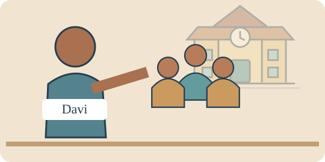

Observe quem aparece, o objeto e o lugar.

- Davi mostra a pessoa.
- Léo mostra o grupo.
- Davi mostra o grupo.

Minha resposta: __________________

### 5. Qual frase combina com a cena?

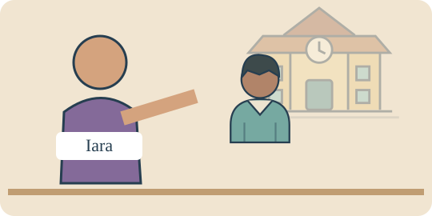

Observe quem aparece, o objeto e o lugar.

- Ana mostra a pessoa.
- Iara mostra a pessoa.
- Iara mostra o livro.

Minha resposta: __________________

### 6. Qual frase combina com a cena?

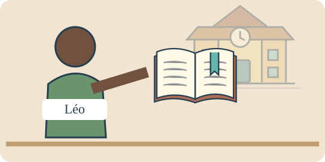

Observe quem aparece, o objeto e o lugar.

- Léo mostra o livro.
- Léo mostra a foto.
- Ravi mostra o livro.

Minha resposta: __________________

### 7. Qual frase combina com a cena?

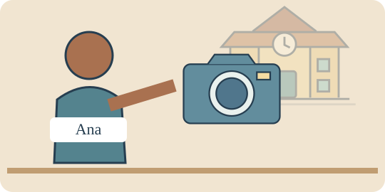

Observe quem aparece, o objeto e o lugar.

- Ana mostra o jornal.
- Eva mostra a foto.
- Ana mostra a foto.

Minha resposta: __________________

### 8. Qual frase combina com a cena?

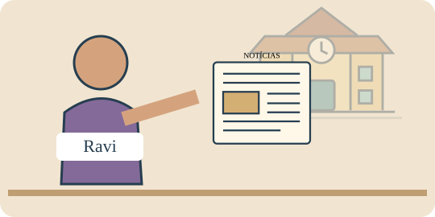

Observe quem aparece, o objeto e o lugar.

- Noa mostra o jornal.
- Ravi mostra o jornal.
- Ravi mostra a praça.

Minha resposta: __________________

### 9. Qual frase combina com a cena?

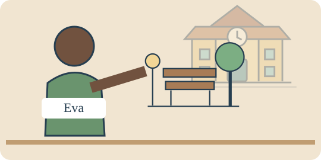

Observe quem aparece, o objeto e o lugar.

- Eva mostra a praça.
- Eva mostra a rua.
- Luz mostra a praça.

Minha resposta: __________________

### 10. Qual frase combina com a cena?

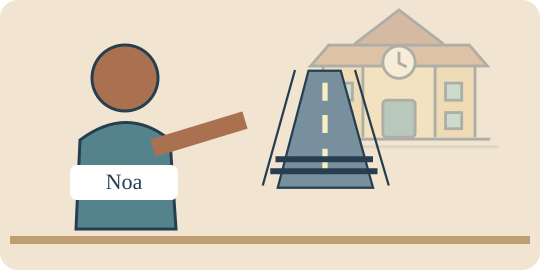

Observe quem aparece, o objeto e o lugar.

- Noa mostra a mão.
- Luísa mostra a rua.
- Noa mostra a rua.

Minha resposta: __________________

### 11. Qual frase combina com a cena?

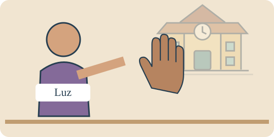

Observe quem aparece, o objeto e o lugar.

- Lia mostra a mão.
- Luz mostra a mão.
- Luz mostra a cor.

Minha resposta: __________________

### 12. Qual frase combina com a cena?

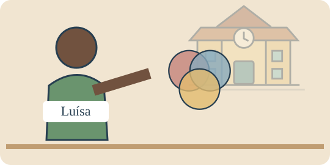

Observe quem aparece, o objeto e o lugar.

- Luísa mostra a cor.
- Luísa mostra o mapa.
- Caio mostra a cor.

Minha resposta: __________________

## Conjunto 2

### 13. Junte duas palavras para começar a frase.

Observe quem aparece, o objeto e o lugar.

- mostra.
- Lia

Minha resposta: __________________

### 14. Junte duas palavras para começar a frase.

Observe quem aparece, o objeto e o lugar.

- Caio
- mostra.

Minha resposta: __________________

### 15. Junte duas palavras para começar a frase.

Observe quem aparece, o objeto e o lugar.

- mostra.
- Bia

Minha resposta: __________________

### 16. Junte duas palavras para começar a frase.

Observe quem aparece, o objeto e o lugar.

- Davi
- mostra.

Minha resposta: __________________

### 17. Junte duas palavras para começar a frase.

Observe quem aparece, o objeto e o lugar.

- mostra.
- Iara

Minha resposta: __________________

### 18. Junte duas palavras para começar a frase.

Observe quem aparece, o objeto e o lugar.

- Léo
- mostra.

Minha resposta: __________________

### 19. Junte duas palavras para começar a frase.

Observe quem aparece, o objeto e o lugar.

- mostra.
- Ana

Minha resposta: __________________

### 20. Junte duas palavras para começar a frase.

Observe quem aparece, o objeto e o lugar.

- Ravi
- mostra.

Minha resposta: __________________

### 21. Junte duas palavras para começar a frase.

Observe quem aparece, o objeto e o lugar.

- mostra.
- Eva

Minha resposta: __________________

### 22. Junte duas palavras para começar a frase.

Observe quem aparece, o objeto e o lugar.

- Noa
- mostra.

Minha resposta: __________________

### 23. Junte duas palavras para começar a frase.

Observe quem aparece, o objeto e o lugar.

- mostra.
- Luz

Minha resposta: __________________

### 24. Junte duas palavras para começar a frase.

Observe quem aparece, o objeto e o lugar.

- Luísa
- mostra.

Minha resposta: __________________

## Conjunto 3

### 25. Quem mostra o objeto?

Observe quem aparece, o objeto e o lugar.

- Caio
- Bia
- Lia

Minha resposta: __________________

### 26. Quem mostra o objeto?

Observe quem aparece, o objeto e o lugar.

- Davi
- Caio
- Bia

Minha resposta: __________________

### 27. Quem mostra o objeto?

Observe quem aparece, o objeto e o lugar.

- Bia
- Davi
- Iara

Minha resposta: __________________

### 28. Quem mostra o objeto?

Observe quem aparece, o objeto e o lugar.

- Iara
- Léo
- Davi

Minha resposta: __________________

### 29. Quem mostra o objeto?

Observe quem aparece, o objeto e o lugar.

- Ana
- Iara
- Léo

Minha resposta: __________________

### 30. Quem mostra o objeto?

Observe quem aparece, o objeto e o lugar.

- Léo
- Ana
- Ravi

Minha resposta: __________________

### 31. Quem mostra o objeto?

Observe quem aparece, o objeto e o lugar.

- Ravi
- Eva
- Ana

Minha resposta: __________________

### 32. Quem mostra o objeto?

Observe quem aparece, o objeto e o lugar.

- Noa
- Ravi
- Eva

Minha resposta: __________________

### 33. Quem mostra o objeto?

Observe quem aparece, o objeto e o lugar.

- Eva
- Noa
- Luz

Minha resposta: __________________

### 34. Quem mostra o objeto?

Observe quem aparece, o objeto e o lugar.

- Luz
- Luísa
- Noa

Minha resposta: __________________

### 35. Quem mostra o objeto?

Observe quem aparece, o objeto e o lugar.

- Lia
- Luz
- Luísa

Minha resposta: __________________

### 36. Quem mostra o objeto?

Observe quem aparece, o objeto e o lugar.

- Luísa
- Lia
- Caio

Minha resposta: __________________

## Conjunto 4

### 37. O que completa a frase?

Lia mostra ___.

- a arte
- um objeto que não aparece
- o mapa

Minha resposta: __________________

### 38. O que completa a frase?

Caio mostra ___.

- um objeto que não aparece
- a arte
- a música

Minha resposta: __________________

### 39. O que completa a frase?

Bia mostra ___.

- a música
- o grupo
- um objeto que não aparece

Minha resposta: __________________

### 40. O que completa a frase?

Davi mostra ___.

- a pessoa
- um objeto que não aparece
- o grupo

Minha resposta: __________________

### 41. O que completa a frase?

Iara mostra ___.

- um objeto que não aparece
- a pessoa
- o livro

Minha resposta: __________________

### 42. O que completa a frase?

Léo mostra ___.

- o livro
- a foto
- um objeto que não aparece

Minha resposta: __________________

### 43. O que completa a frase?

Ana mostra ___.

- o jornal
- um objeto que não aparece
- a foto

Minha resposta: __________________

### 44. O que completa a frase?

Ravi mostra ___.

- um objeto que não aparece
- o jornal
- a praça

Minha resposta: __________________

### 45. O que completa a frase?

Eva mostra ___.

- a praça
- a rua
- um objeto que não aparece

Minha resposta: __________________

### 46. O que completa a frase?

Noa mostra ___.

- a mão
- um objeto que não aparece
- a rua

Minha resposta: __________________

### 47. O que completa a frase?

Luz mostra ___.

- um objeto que não aparece
- a mão
- a cor

Minha resposta: __________________

### 48. O que completa a frase?

Luísa mostra ___.

- a cor
- o mapa
- um objeto que não aparece

Minha resposta: __________________

## Conjunto 5

### 49. Monte a frase completa.

Observe quem aparece, o objeto e o lugar.

- mostra
- o mapa.
- Lia

Minha resposta: __________________

### 50. Monte a frase completa.

Observe quem aparece, o objeto e o lugar.

- a arte.
- Caio
- mostra

Minha resposta: __________________

### 51. Monte a frase completa.

Observe quem aparece, o objeto e o lugar.

- Bia
- mostra
- a música.

Minha resposta: __________________

### 52. Monte a frase completa.

Observe quem aparece, o objeto e o lugar.

- mostra
- o grupo.
- Davi

Minha resposta: __________________

### 53. Monte a frase completa.

Observe quem aparece, o objeto e o lugar.

- a pessoa.
- Iara
- mostra

Minha resposta: __________________

### 54. Monte a frase completa.

Observe quem aparece, o objeto e o lugar.

- Léo
- mostra
- o livro.

Minha resposta: __________________

### 55. Monte a frase completa.

Observe quem aparece, o objeto e o lugar.

- mostra
- a foto.
- Ana

Minha resposta: __________________

### 56. Monte a frase completa.

Observe quem aparece, o objeto e o lugar.

- o jornal.
- Ravi
- mostra

Minha resposta: __________________

### 57. Monte a frase completa.

Observe quem aparece, o objeto e o lugar.

- Eva
- mostra
- a praça.

Minha resposta: __________________

### 58. Monte a frase completa.

Observe quem aparece, o objeto e o lugar.

- mostra
- a rua.
- Noa

Minha resposta: __________________

### 59. Monte a frase completa.

Observe quem aparece, o objeto e o lugar.

- a mão.
- Luz
- mostra

Minha resposta: __________________

### 60. Monte a frase completa.

Observe quem aparece, o objeto e o lugar.

- Luísa
- mostra
- a cor.

Minha resposta: __________________

## Conjunto 6

### 61. Qual frase acrescenta o lugar da cena?

Observe quem aparece, o objeto e o lugar.

- Lia mostra o mapa na rua.
- Lia mostra o mapa na ponte.
- Lia mostra o mapa na escola.

Minha resposta: __________________

### 62. Qual frase acrescenta o lugar da cena?

Observe quem aparece, o objeto e o lugar.

- Caio mostra a arte na ponte.
- Caio mostra a arte na escola.
- Caio mostra a arte na rua.

Minha resposta: __________________

### 63. Qual frase acrescenta o lugar da cena?

Observe quem aparece, o objeto e o lugar.

- Bia mostra a música na escola.
- Bia mostra a música na rua.
- Bia mostra a música na ponte.

Minha resposta: __________________

### 64. Qual frase acrescenta o lugar da cena?

Observe quem aparece, o objeto e o lugar.

- Davi mostra o grupo na rua.
- Davi mostra o grupo na ponte.
- Davi mostra o grupo na escola.

Minha resposta: __________________

### 65. Qual frase acrescenta o lugar da cena?

Observe quem aparece, o objeto e o lugar.

- Iara mostra a pessoa na ponte.
- Iara mostra a pessoa na escola.
- Iara mostra a pessoa na rua.

Minha resposta: __________________

### 66. Qual frase acrescenta o lugar da cena?

Observe quem aparece, o objeto e o lugar.

- Léo mostra o livro na escola.
- Léo mostra o livro na rua.
- Léo mostra o livro na ponte.

Minha resposta: __________________

### 67. Qual frase acrescenta o lugar da cena?

Observe quem aparece, o objeto e o lugar.

- Ana mostra a foto na rua.
- Ana mostra a foto na ponte.
- Ana mostra a foto na escola.

Minha resposta: __________________

### 68. Qual frase acrescenta o lugar da cena?

Observe quem aparece, o objeto e o lugar.

- Ravi mostra o jornal na ponte.
- Ravi mostra o jornal na escola.
- Ravi mostra o jornal na rua.

Minha resposta: __________________

### 69. Qual frase acrescenta o lugar da cena?

Observe quem aparece, o objeto e o lugar.

- Eva mostra a praça na escola.
- Eva mostra a praça na rua.
- Eva mostra a praça na ponte.

Minha resposta: __________________

### 70. Qual frase acrescenta o lugar da cena?

Observe quem aparece, o objeto e o lugar.

- Noa mostra a rua na rua.
- Noa mostra a rua na ponte.
- Noa mostra a rua na escola.

Minha resposta: __________________

### 71. Qual frase acrescenta o lugar da cena?

Observe quem aparece, o objeto e o lugar.

- Luz mostra a mão na ponte.
- Luz mostra a mão na escola.
- Luz mostra a mão na rua.

Minha resposta: __________________

### 72. Qual frase acrescenta o lugar da cena?

Observe quem aparece, o objeto e o lugar.

- Luísa mostra a cor na escola.
- Luísa mostra a cor na rua.
- Luísa mostra a cor na ponte.

Minha resposta: __________________

## Conjunto 7

### 73. Qual frase conta as imagens na ordem?

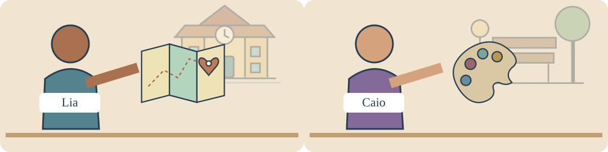

Observe quem aparece, o objeto e o lugar.

- Caio mostra a arte. Depois, Lia mostra o mapa.
- As duas imagens mostram a mesma pessoa com o mesmo objeto.
- Lia mostra o mapa. Depois, Caio mostra a arte.

Minha resposta: __________________

### 74. Qual frase conta as imagens na ordem?

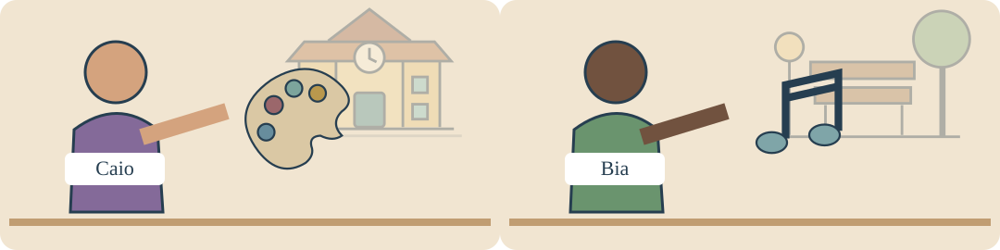

Observe quem aparece, o objeto e o lugar.

- As duas imagens mostram a mesma pessoa com o mesmo objeto.
- Caio mostra a arte. Depois, Bia mostra a música.
- Bia mostra a música. Depois, Caio mostra a arte.

Minha resposta: __________________

### 75. Qual frase conta as imagens na ordem?

Observe quem aparece, o objeto e o lugar.

- Bia mostra a música. Depois, Davi mostra o grupo.
- Davi mostra o grupo. Depois, Bia mostra a música.
- As duas imagens mostram a mesma pessoa com o mesmo objeto.

Minha resposta: __________________

### 76. Qual frase conta as imagens na ordem?

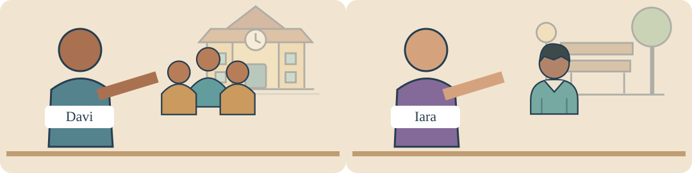

Observe quem aparece, o objeto e o lugar.

- Iara mostra a pessoa. Depois, Davi mostra o grupo.
- As duas imagens mostram a mesma pessoa com o mesmo objeto.
- Davi mostra o grupo. Depois, Iara mostra a pessoa.

Minha resposta: __________________

### 77. Qual frase conta as imagens na ordem?

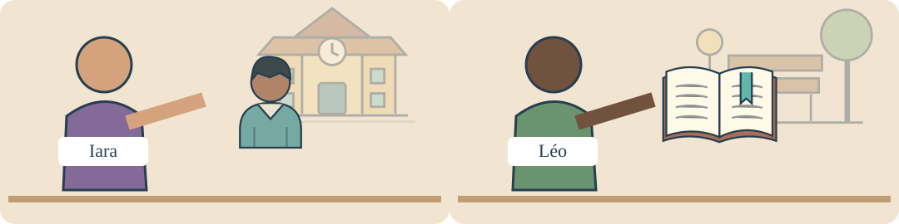

Observe quem aparece, o objeto e o lugar.

- As duas imagens mostram a mesma pessoa com o mesmo objeto.
- Iara mostra a pessoa. Depois, Léo mostra o livro.
- Léo mostra o livro. Depois, Iara mostra a pessoa.

Minha resposta: __________________

### 78. Qual frase conta as imagens na ordem?

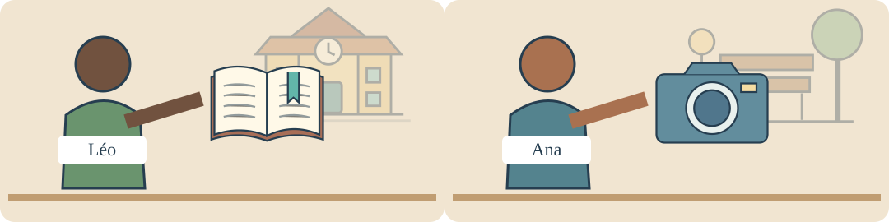

Observe quem aparece, o objeto e o lugar.

- Léo mostra o livro. Depois, Ana mostra a foto.
- Ana mostra a foto. Depois, Léo mostra o livro.
- As duas imagens mostram a mesma pessoa com o mesmo objeto.

Minha resposta: __________________

### 79. Qual frase conta as imagens na ordem?

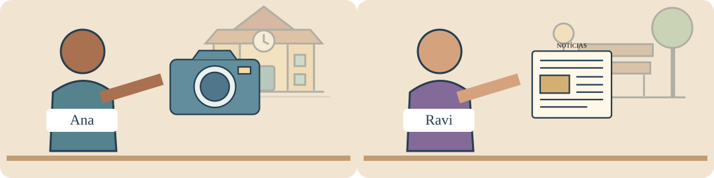

Observe quem aparece, o objeto e o lugar.

- Ravi mostra o jornal. Depois, Ana mostra a foto.
- As duas imagens mostram a mesma pessoa com o mesmo objeto.
- Ana mostra a foto. Depois, Ravi mostra o jornal.

Minha resposta: __________________

### 80. Qual frase conta as imagens na ordem?

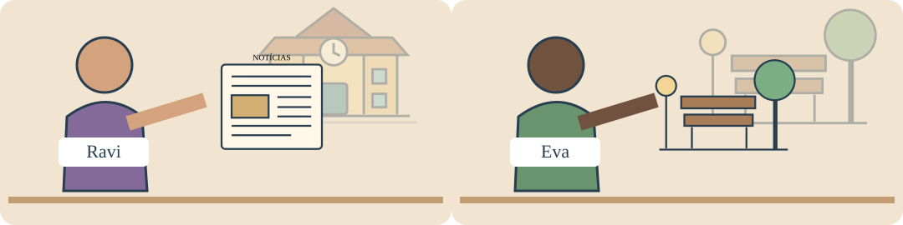

Observe quem aparece, o objeto e o lugar.

- As duas imagens mostram a mesma pessoa com o mesmo objeto.
- Ravi mostra o jornal. Depois, Eva mostra a praça.
- Eva mostra a praça. Depois, Ravi mostra o jornal.

Minha resposta: __________________

### 81. Qual frase conta as imagens na ordem?

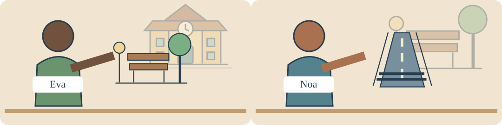

Observe quem aparece, o objeto e o lugar.

- Eva mostra a praça. Depois, Noa mostra a rua.
- Noa mostra a rua. Depois, Eva mostra a praça.
- As duas imagens mostram a mesma pessoa com o mesmo objeto.

Minha resposta: __________________

### 82. Qual frase conta as imagens na ordem?

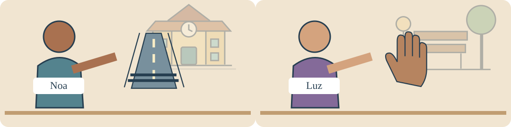

Observe quem aparece, o objeto e o lugar.

- Luz mostra a mão. Depois, Noa mostra a rua.
- As duas imagens mostram a mesma pessoa com o mesmo objeto.
- Noa mostra a rua. Depois, Luz mostra a mão.

Minha resposta: __________________

### 83. Qual frase conta as imagens na ordem?

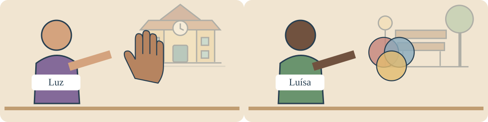

Observe quem aparece, o objeto e o lugar.

- As duas imagens mostram a mesma pessoa com o mesmo objeto.
- Luz mostra a mão. Depois, Luísa mostra a cor.
- Luísa mostra a cor. Depois, Luz mostra a mão.

Minha resposta: __________________

### 84. Qual frase conta as imagens na ordem?

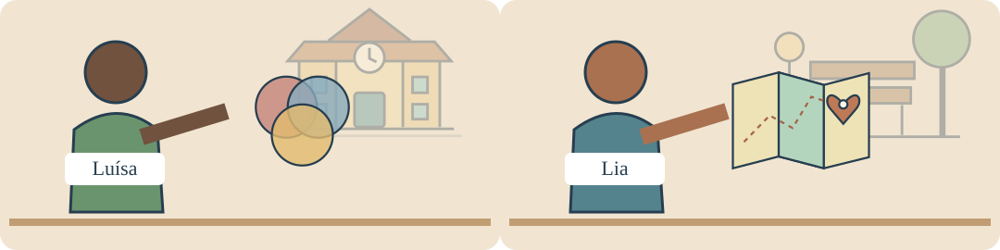

Observe quem aparece, o objeto e o lugar.

- Luísa mostra a cor. Depois, Lia mostra o mapa.
- Lia mostra o mapa. Depois, Luísa mostra a cor.
- As duas imagens mostram a mesma pessoa com o mesmo objeto.

Minha resposta: __________________

## Conjunto 8

### 85. Qual frase combina com a cena?

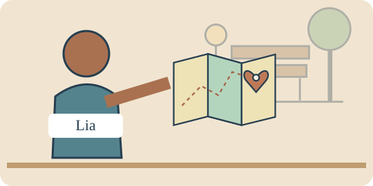

Observe quem aparece, o objeto e o lugar.

- Lia mostra a arte.
- Bia mostra o mapa.
- Lia mostra o mapa.

Minha resposta: __________________

### 86. Qual frase combina com a cena?

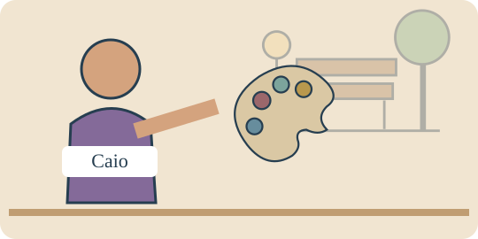

Observe quem aparece, o objeto e o lugar.

- Davi mostra a arte.
- Caio mostra a arte.
- Caio mostra a música.

Minha resposta: __________________

### 87. Qual frase combina com a cena?

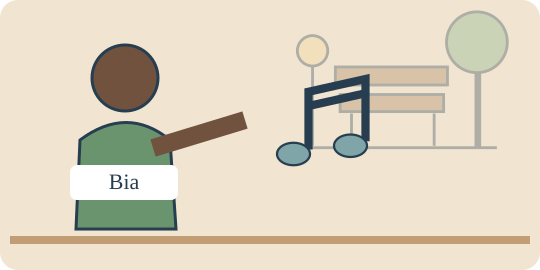

Observe quem aparece, o objeto e o lugar.

- Bia mostra a música.
- Bia mostra o grupo.
- Iara mostra a música.

Minha resposta: __________________

### 88. Qual frase combina com a cena?

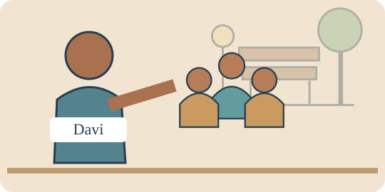

Observe quem aparece, o objeto e o lugar.

- Davi mostra a pessoa.
- Léo mostra o grupo.
- Davi mostra o grupo.

Minha resposta: __________________

### 89. Qual frase combina com a cena?

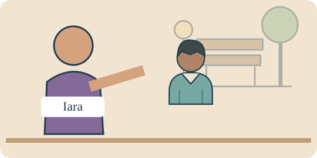

Observe quem aparece, o objeto e o lugar.

- Ana mostra a pessoa.
- Iara mostra a pessoa.
- Iara mostra o livro.

Minha resposta: __________________

### 90. Qual frase combina com a cena?

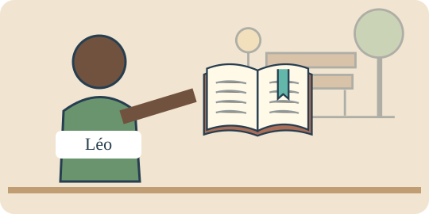

Observe quem aparece, o objeto e o lugar.

- Léo mostra o livro.
- Léo mostra a foto.
- Ravi mostra o livro.

Minha resposta: __________________

### 91. Qual frase combina com a cena?

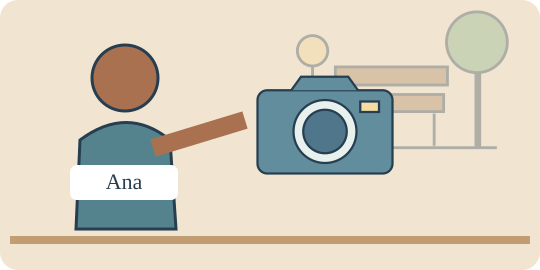

Observe quem aparece, o objeto e o lugar.

- Ana mostra o jornal.
- Eva mostra a foto.
- Ana mostra a foto.

Minha resposta: __________________

### 92. Qual frase combina com a cena?

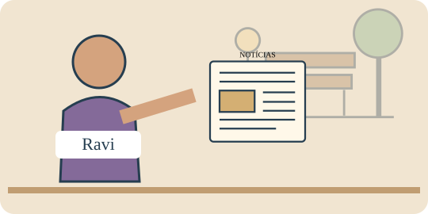

Observe quem aparece, o objeto e o lugar.

- Noa mostra o jornal.
- Ravi mostra o jornal.
- Ravi mostra a praça.

Minha resposta: __________________

### 93. Qual frase combina com a cena?

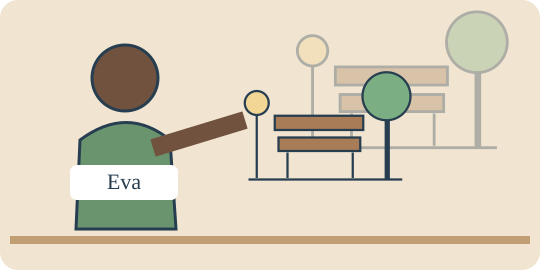

Observe quem aparece, o objeto e o lugar.

- Eva mostra a praça.
- Eva mostra a rua.
- Luz mostra a praça.

Minha resposta: __________________

### 94. Qual frase combina com a cena?

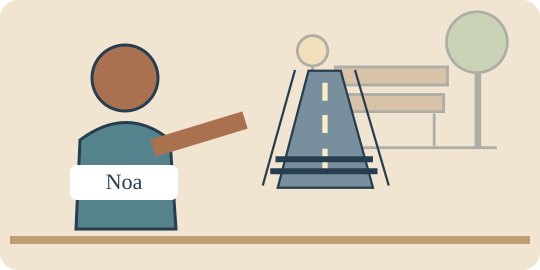

Observe quem aparece, o objeto e o lugar.

- Noa mostra a mão.
- Luísa mostra a rua.
- Noa mostra a rua.

Minha resposta: __________________

### 95. Qual frase combina com a cena?

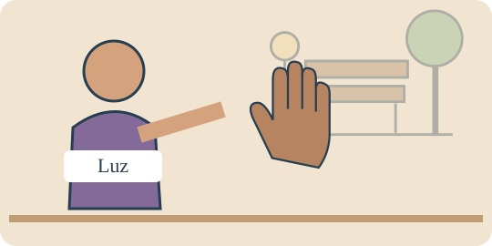

Observe quem aparece, o objeto e o lugar.

- Lia mostra a mão.
- Luz mostra a mão.
- Luz mostra a cor.

Minha resposta: __________________

### 96. Qual frase combina com a cena?

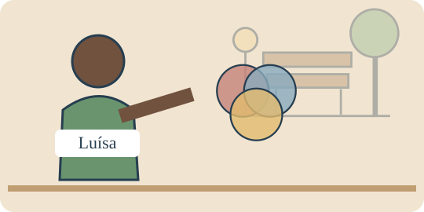

Observe quem aparece, o objeto e o lugar.

- Luísa mostra a cor.
- Luísa mostra o mapa.
- Caio mostra a cor.

Minha resposta: __________________

