# O que a tabela mostra? — Frases opcionais

**8º ano · Estudos Orientados**

[Voltar ao apoio](apoio-leitura.md)

Escolha este caminho depois da primeira fase. Observe as pessoas, os objetos e os lugares; peça leitura das opções quando precisar. Há 96 atividades retomáveis.

## Conjunto 1

### 1. Qual frase combina com a cena?

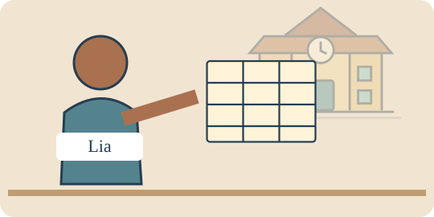

Observe quem aparece, o objeto e o lugar.

- Lia mostra o caderno.
- Bia mostra a tabela.
- Lia mostra a tabela.

Minha resposta: __________________

### 2. Qual frase combina com a cena?

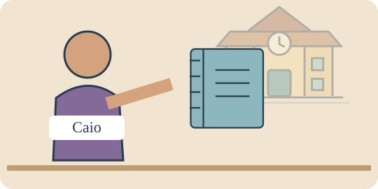

Observe quem aparece, o objeto e o lugar.

- Davi mostra o caderno.
- Caio mostra o caderno.
- Caio mostra o lápis.

Minha resposta: __________________

### 3. Qual frase combina com a cena?

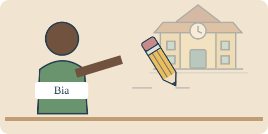

Observe quem aparece, o objeto e o lugar.

- Bia mostra o lápis.
- Bia mostra a régua.
- Iara mostra o lápis.

Minha resposta: __________________

### 4. Qual frase combina com a cena?

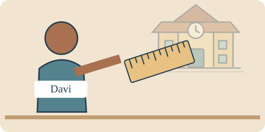

Observe quem aparece, o objeto e o lugar.

- Davi mostra o tempo.
- Léo mostra a régua.
- Davi mostra a régua.

Minha resposta: __________________

### 5. Qual frase combina com a cena?

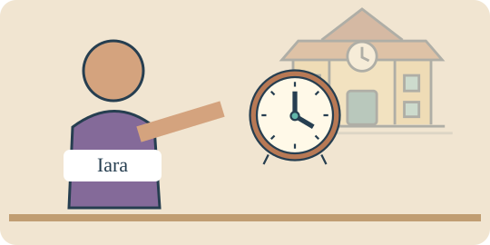

Observe quem aparece, o objeto e o lugar.

- Ana mostra o tempo.
- Iara mostra o tempo.
- Iara mostra o dado.

Minha resposta: __________________

### 6. Qual frase combina com a cena?

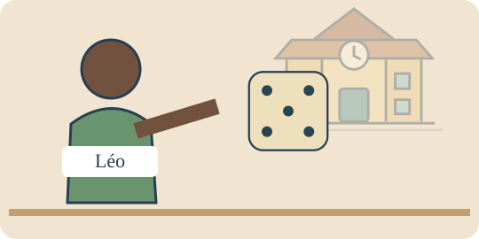

Observe quem aparece, o objeto e o lugar.

- Léo mostra o dado.
- Léo mostra o número.
- Ravi mostra o dado.

Minha resposta: __________________

### 7. Qual frase combina com a cena?

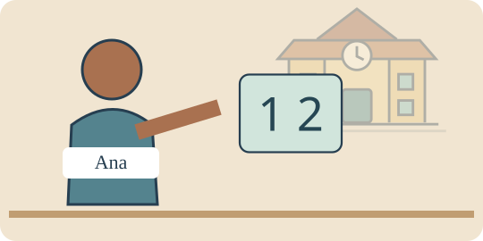

Observe quem aparece, o objeto e o lugar.

- Ana mostra o mapa.
- Eva mostra o número.
- Ana mostra o número.

Minha resposta: __________________

### 8. Qual frase combina com a cena?

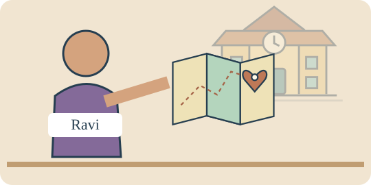

Observe quem aparece, o objeto e o lugar.

- Noa mostra o mapa.
- Ravi mostra o mapa.
- Ravi mostra o papel.

Minha resposta: __________________

### 9. Qual frase combina com a cena?

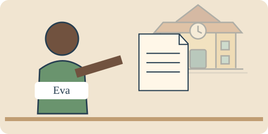

Observe quem aparece, o objeto e o lugar.

- Eva mostra o papel.
- Eva mostra a ficha.
- Luz mostra o papel.

Minha resposta: __________________

### 10. Qual frase combina com a cena?

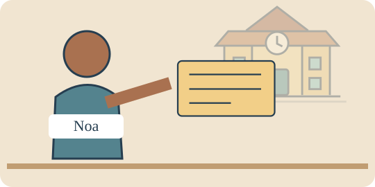

Observe quem aparece, o objeto e o lugar.

- Noa mostra a agenda.
- Luísa mostra a ficha.
- Noa mostra a ficha.

Minha resposta: __________________

### 11. Qual frase combina com a cena?

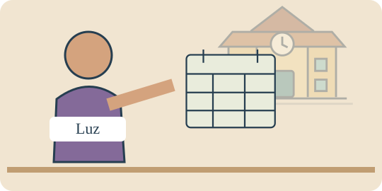

Observe quem aparece, o objeto e o lugar.

- Lia mostra a agenda.
- Luz mostra a agenda.
- Luz mostra a bolsa.

Minha resposta: __________________

### 12. Qual frase combina com a cena?

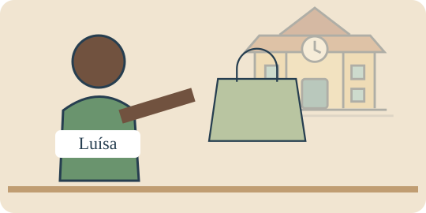

Observe quem aparece, o objeto e o lugar.

- Luísa mostra a bolsa.
- Luísa mostra a tabela.
- Caio mostra a bolsa.

Minha resposta: __________________

## Conjunto 2

### 13. Junte duas palavras para começar a frase.

Observe quem aparece, o objeto e o lugar.

- mostra.
- Lia

Minha resposta: __________________

### 14. Junte duas palavras para começar a frase.

Observe quem aparece, o objeto e o lugar.

- Caio
- mostra.

Minha resposta: __________________

### 15. Junte duas palavras para começar a frase.

Observe quem aparece, o objeto e o lugar.

- mostra.
- Bia

Minha resposta: __________________

### 16. Junte duas palavras para começar a frase.

Observe quem aparece, o objeto e o lugar.

- Davi
- mostra.

Minha resposta: __________________

### 17. Junte duas palavras para começar a frase.

Observe quem aparece, o objeto e o lugar.

- mostra.
- Iara

Minha resposta: __________________

### 18. Junte duas palavras para começar a frase.

Observe quem aparece, o objeto e o lugar.

- Léo
- mostra.

Minha resposta: __________________

### 19. Junte duas palavras para começar a frase.

Observe quem aparece, o objeto e o lugar.

- mostra.
- Ana

Minha resposta: __________________

### 20. Junte duas palavras para começar a frase.

Observe quem aparece, o objeto e o lugar.

- Ravi
- mostra.

Minha resposta: __________________

### 21. Junte duas palavras para começar a frase.

Observe quem aparece, o objeto e o lugar.

- mostra.
- Eva

Minha resposta: __________________

### 22. Junte duas palavras para começar a frase.

Observe quem aparece, o objeto e o lugar.

- Noa
- mostra.

Minha resposta: __________________

### 23. Junte duas palavras para começar a frase.

Observe quem aparece, o objeto e o lugar.

- mostra.
- Luz

Minha resposta: __________________

### 24. Junte duas palavras para começar a frase.

Observe quem aparece, o objeto e o lugar.

- Luísa
- mostra.

Minha resposta: __________________

## Conjunto 3

### 25. Quem mostra o objeto?

Observe quem aparece, o objeto e o lugar.

- Caio
- Bia
- Lia

Minha resposta: __________________

### 26. Quem mostra o objeto?

Observe quem aparece, o objeto e o lugar.

- Davi
- Caio
- Bia

Minha resposta: __________________

### 27. Quem mostra o objeto?

Observe quem aparece, o objeto e o lugar.

- Bia
- Davi
- Iara

Minha resposta: __________________

### 28. Quem mostra o objeto?

Observe quem aparece, o objeto e o lugar.

- Iara
- Léo
- Davi

Minha resposta: __________________

### 29. Quem mostra o objeto?

Observe quem aparece, o objeto e o lugar.

- Ana
- Iara
- Léo

Minha resposta: __________________

### 30. Quem mostra o objeto?

Observe quem aparece, o objeto e o lugar.

- Léo
- Ana
- Ravi

Minha resposta: __________________

### 31. Quem mostra o objeto?

Observe quem aparece, o objeto e o lugar.

- Ravi
- Eva
- Ana

Minha resposta: __________________

### 32. Quem mostra o objeto?

Observe quem aparece, o objeto e o lugar.

- Noa
- Ravi
- Eva

Minha resposta: __________________

### 33. Quem mostra o objeto?

Observe quem aparece, o objeto e o lugar.

- Eva
- Noa
- Luz

Minha resposta: __________________

### 34. Quem mostra o objeto?

Observe quem aparece, o objeto e o lugar.

- Luz
- Luísa
- Noa

Minha resposta: __________________

### 35. Quem mostra o objeto?

Observe quem aparece, o objeto e o lugar.

- Lia
- Luz
- Luísa

Minha resposta: __________________

### 36. Quem mostra o objeto?

Observe quem aparece, o objeto e o lugar.

- Luísa
- Lia
- Caio

Minha resposta: __________________

## Conjunto 4

### 37. O que completa a frase?

Lia mostra ___.

- o caderno
- um objeto que não aparece
- a tabela

Minha resposta: __________________

### 38. O que completa a frase?

Caio mostra ___.

- um objeto que não aparece
- o caderno
- o lápis

Minha resposta: __________________

### 39. O que completa a frase?

Bia mostra ___.

- o lápis
- a régua
- um objeto que não aparece

Minha resposta: __________________

### 40. O que completa a frase?

Davi mostra ___.

- o tempo
- um objeto que não aparece
- a régua

Minha resposta: __________________

### 41. O que completa a frase?

Iara mostra ___.

- um objeto que não aparece
- o tempo
- o dado

Minha resposta: __________________

### 42. O que completa a frase?

Léo mostra ___.

- o dado
- o número
- um objeto que não aparece

Minha resposta: __________________

### 43. O que completa a frase?

Ana mostra ___.

- o mapa
- um objeto que não aparece
- o número

Minha resposta: __________________

### 44. O que completa a frase?

Ravi mostra ___.

- um objeto que não aparece
- o mapa
- o papel

Minha resposta: __________________

### 45. O que completa a frase?

Eva mostra ___.

- o papel
- a ficha
- um objeto que não aparece

Minha resposta: __________________

### 46. O que completa a frase?

Noa mostra ___.

- a agenda
- um objeto que não aparece
- a ficha

Minha resposta: __________________

### 47. O que completa a frase?

Luz mostra ___.

- um objeto que não aparece
- a agenda
- a bolsa

Minha resposta: __________________

### 48. O que completa a frase?

Luísa mostra ___.

- a bolsa
- a tabela
- um objeto que não aparece

Minha resposta: __________________

## Conjunto 5

### 49. Monte a frase completa.

Observe quem aparece, o objeto e o lugar.

- mostra
- a tabela.
- Lia

Minha resposta: __________________

### 50. Monte a frase completa.

Observe quem aparece, o objeto e o lugar.

- o caderno.
- Caio
- mostra

Minha resposta: __________________

### 51. Monte a frase completa.

Observe quem aparece, o objeto e o lugar.

- Bia
- mostra
- o lápis.

Minha resposta: __________________

### 52. Monte a frase completa.

Observe quem aparece, o objeto e o lugar.

- mostra
- a régua.
- Davi

Minha resposta: __________________

### 53. Monte a frase completa.

Observe quem aparece, o objeto e o lugar.

- o tempo.
- Iara
- mostra

Minha resposta: __________________

### 54. Monte a frase completa.

Observe quem aparece, o objeto e o lugar.

- Léo
- mostra
- o dado.

Minha resposta: __________________

### 55. Monte a frase completa.

Observe quem aparece, o objeto e o lugar.

- mostra
- o número.
- Ana

Minha resposta: __________________

### 56. Monte a frase completa.

Observe quem aparece, o objeto e o lugar.

- o mapa.
- Ravi
- mostra

Minha resposta: __________________

### 57. Monte a frase completa.

Observe quem aparece, o objeto e o lugar.

- Eva
- mostra
- o papel.

Minha resposta: __________________

### 58. Monte a frase completa.

Observe quem aparece, o objeto e o lugar.

- mostra
- a ficha.
- Noa

Minha resposta: __________________

### 59. Monte a frase completa.

Observe quem aparece, o objeto e o lugar.

- a agenda.
- Luz
- mostra

Minha resposta: __________________

### 60. Monte a frase completa.

Observe quem aparece, o objeto e o lugar.

- Luísa
- mostra
- a bolsa.

Minha resposta: __________________

## Conjunto 6

### 61. Qual frase acrescenta o lugar da cena?

Observe quem aparece, o objeto e o lugar.

- Lia mostra a tabela na rua.
- Lia mostra a tabela na ponte.
- Lia mostra a tabela na escola.

Minha resposta: __________________

### 62. Qual frase acrescenta o lugar da cena?

Observe quem aparece, o objeto e o lugar.

- Caio mostra o caderno na ponte.
- Caio mostra o caderno na escola.
- Caio mostra o caderno na rua.

Minha resposta: __________________

### 63. Qual frase acrescenta o lugar da cena?

Observe quem aparece, o objeto e o lugar.

- Bia mostra o lápis na escola.
- Bia mostra o lápis na rua.
- Bia mostra o lápis na ponte.

Minha resposta: __________________

### 64. Qual frase acrescenta o lugar da cena?

Observe quem aparece, o objeto e o lugar.

- Davi mostra a régua na rua.
- Davi mostra a régua na ponte.
- Davi mostra a régua na escola.

Minha resposta: __________________

### 65. Qual frase acrescenta o lugar da cena?

Observe quem aparece, o objeto e o lugar.

- Iara mostra o tempo na ponte.
- Iara mostra o tempo na escola.
- Iara mostra o tempo na rua.

Minha resposta: __________________

### 66. Qual frase acrescenta o lugar da cena?

Observe quem aparece, o objeto e o lugar.

- Léo mostra o dado na escola.
- Léo mostra o dado na rua.
- Léo mostra o dado na ponte.

Minha resposta: __________________

### 67. Qual frase acrescenta o lugar da cena?

Observe quem aparece, o objeto e o lugar.

- Ana mostra o número na rua.
- Ana mostra o número na ponte.
- Ana mostra o número na escola.

Minha resposta: __________________

### 68. Qual frase acrescenta o lugar da cena?

Observe quem aparece, o objeto e o lugar.

- Ravi mostra o mapa na ponte.
- Ravi mostra o mapa na escola.
- Ravi mostra o mapa na rua.

Minha resposta: __________________

### 69. Qual frase acrescenta o lugar da cena?

Observe quem aparece, o objeto e o lugar.

- Eva mostra o papel na escola.
- Eva mostra o papel na rua.
- Eva mostra o papel na ponte.

Minha resposta: __________________

### 70. Qual frase acrescenta o lugar da cena?

Observe quem aparece, o objeto e o lugar.

- Noa mostra a ficha na rua.
- Noa mostra a ficha na ponte.
- Noa mostra a ficha na escola.

Minha resposta: __________________

### 71. Qual frase acrescenta o lugar da cena?

Observe quem aparece, o objeto e o lugar.

- Luz mostra a agenda na ponte.
- Luz mostra a agenda na escola.
- Luz mostra a agenda na rua.

Minha resposta: __________________

### 72. Qual frase acrescenta o lugar da cena?

Observe quem aparece, o objeto e o lugar.

- Luísa mostra a bolsa na escola.
- Luísa mostra a bolsa na rua.
- Luísa mostra a bolsa na ponte.

Minha resposta: __________________

## Conjunto 7

### 73. Qual frase conta as imagens na ordem?

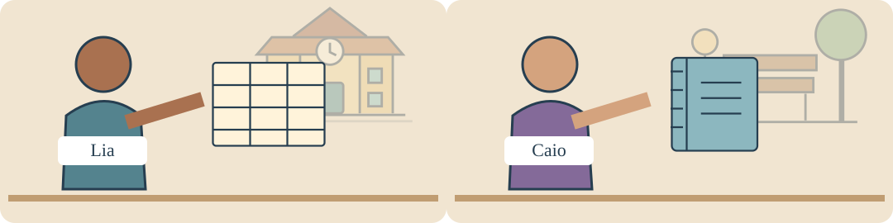

Observe quem aparece, o objeto e o lugar.

- Caio mostra o caderno. Depois, Lia mostra a tabela.
- As duas imagens mostram a mesma pessoa com o mesmo objeto.
- Lia mostra a tabela. Depois, Caio mostra o caderno.

Minha resposta: __________________

### 74. Qual frase conta as imagens na ordem?

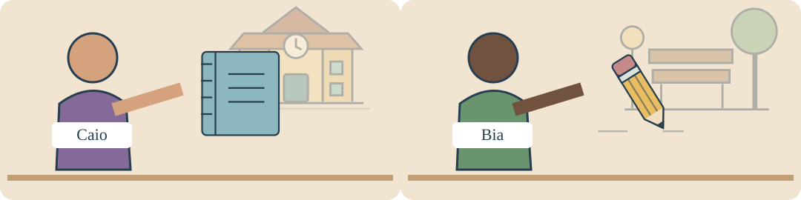

Observe quem aparece, o objeto e o lugar.

- As duas imagens mostram a mesma pessoa com o mesmo objeto.
- Caio mostra o caderno. Depois, Bia mostra o lápis.
- Bia mostra o lápis. Depois, Caio mostra o caderno.

Minha resposta: __________________

### 75. Qual frase conta as imagens na ordem?

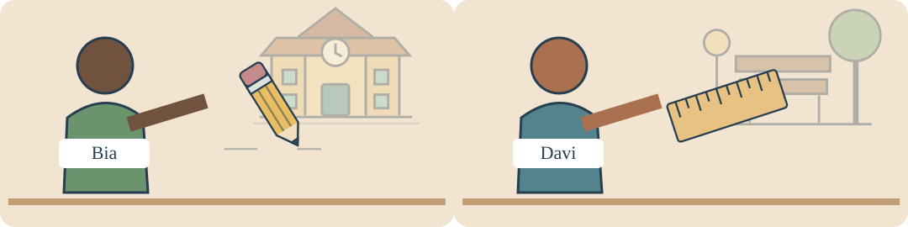

Observe quem aparece, o objeto e o lugar.

- Bia mostra o lápis. Depois, Davi mostra a régua.
- Davi mostra a régua. Depois, Bia mostra o lápis.
- As duas imagens mostram a mesma pessoa com o mesmo objeto.

Minha resposta: __________________

### 76. Qual frase conta as imagens na ordem?

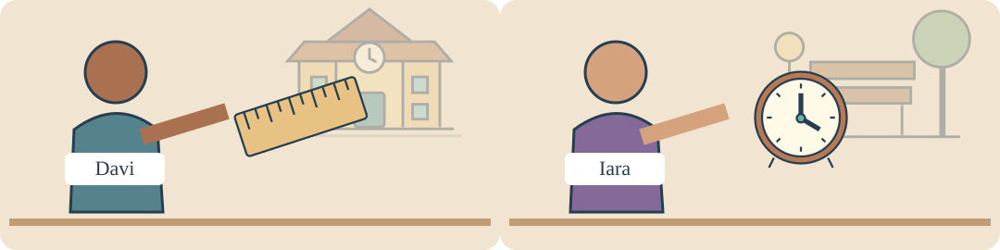

Observe quem aparece, o objeto e o lugar.

- Iara mostra o tempo. Depois, Davi mostra a régua.
- As duas imagens mostram a mesma pessoa com o mesmo objeto.
- Davi mostra a régua. Depois, Iara mostra o tempo.

Minha resposta: __________________

### 77. Qual frase conta as imagens na ordem?

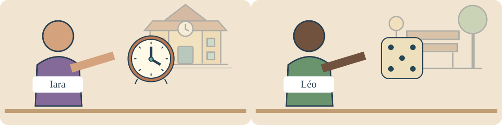

Observe quem aparece, o objeto e o lugar.

- As duas imagens mostram a mesma pessoa com o mesmo objeto.
- Iara mostra o tempo. Depois, Léo mostra o dado.
- Léo mostra o dado. Depois, Iara mostra o tempo.

Minha resposta: __________________

### 78. Qual frase conta as imagens na ordem?

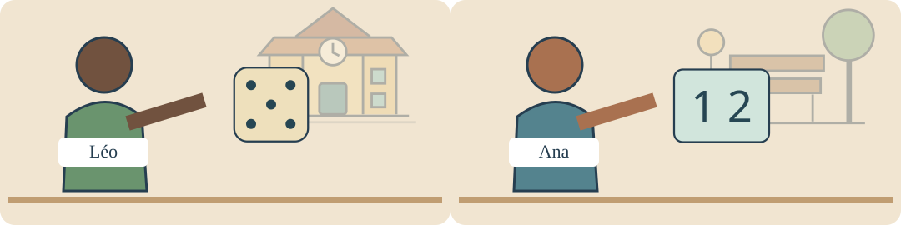

Observe quem aparece, o objeto e o lugar.

- Léo mostra o dado. Depois, Ana mostra o número.
- Ana mostra o número. Depois, Léo mostra o dado.
- As duas imagens mostram a mesma pessoa com o mesmo objeto.

Minha resposta: __________________

### 79. Qual frase conta as imagens na ordem?

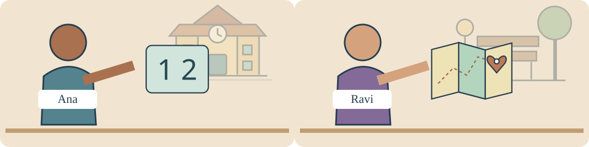

Observe quem aparece, o objeto e o lugar.

- Ravi mostra o mapa. Depois, Ana mostra o número.
- As duas imagens mostram a mesma pessoa com o mesmo objeto.
- Ana mostra o número. Depois, Ravi mostra o mapa.

Minha resposta: __________________

### 80. Qual frase conta as imagens na ordem?

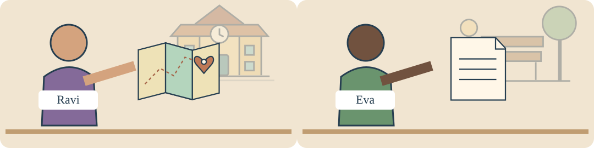

Observe quem aparece, o objeto e o lugar.

- As duas imagens mostram a mesma pessoa com o mesmo objeto.
- Ravi mostra o mapa. Depois, Eva mostra o papel.
- Eva mostra o papel. Depois, Ravi mostra o mapa.

Minha resposta: __________________

### 81. Qual frase conta as imagens na ordem?

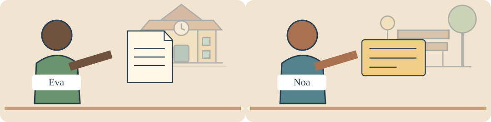

Observe quem aparece, o objeto e o lugar.

- Eva mostra o papel. Depois, Noa mostra a ficha.
- Noa mostra a ficha. Depois, Eva mostra o papel.
- As duas imagens mostram a mesma pessoa com o mesmo objeto.

Minha resposta: __________________

### 82. Qual frase conta as imagens na ordem?

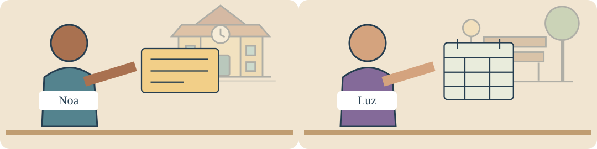

Observe quem aparece, o objeto e o lugar.

- Luz mostra a agenda. Depois, Noa mostra a ficha.
- As duas imagens mostram a mesma pessoa com o mesmo objeto.
- Noa mostra a ficha. Depois, Luz mostra a agenda.

Minha resposta: __________________

### 83. Qual frase conta as imagens na ordem?

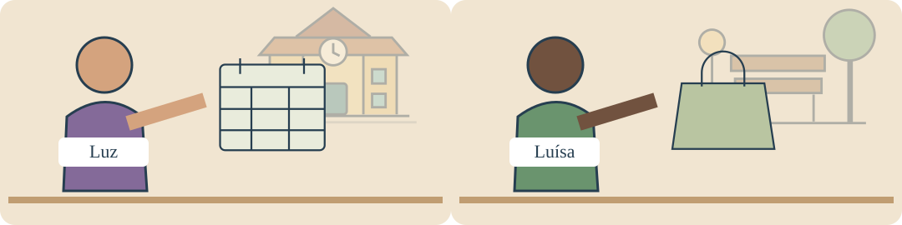

Observe quem aparece, o objeto e o lugar.

- As duas imagens mostram a mesma pessoa com o mesmo objeto.
- Luz mostra a agenda. Depois, Luísa mostra a bolsa.
- Luísa mostra a bolsa. Depois, Luz mostra a agenda.

Minha resposta: __________________

### 84. Qual frase conta as imagens na ordem?

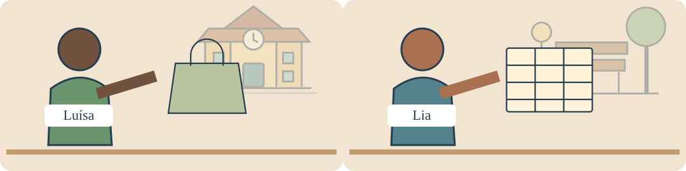

Observe quem aparece, o objeto e o lugar.

- Luísa mostra a bolsa. Depois, Lia mostra a tabela.
- Lia mostra a tabela. Depois, Luísa mostra a bolsa.
- As duas imagens mostram a mesma pessoa com o mesmo objeto.

Minha resposta: __________________

## Conjunto 8

### 85. Qual frase combina com a cena?

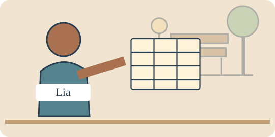

Observe quem aparece, o objeto e o lugar.

- Lia mostra o caderno.
- Bia mostra a tabela.
- Lia mostra a tabela.

Minha resposta: __________________

### 86. Qual frase combina com a cena?

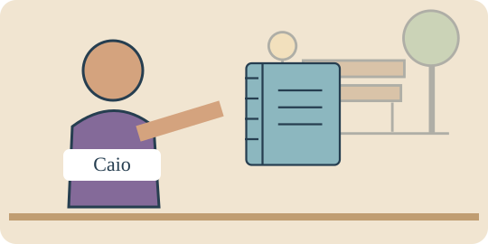

Observe quem aparece, o objeto e o lugar.

- Davi mostra o caderno.
- Caio mostra o caderno.
- Caio mostra o lápis.

Minha resposta: __________________

### 87. Qual frase combina com a cena?

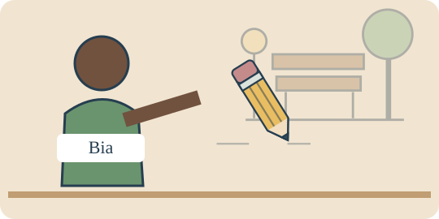

Observe quem aparece, o objeto e o lugar.

- Bia mostra o lápis.
- Bia mostra a régua.
- Iara mostra o lápis.

Minha resposta: __________________

### 88. Qual frase combina com a cena?

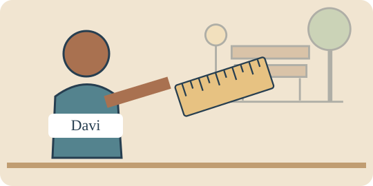

Observe quem aparece, o objeto e o lugar.

- Davi mostra o tempo.
- Léo mostra a régua.
- Davi mostra a régua.

Minha resposta: __________________

### 89. Qual frase combina com a cena?

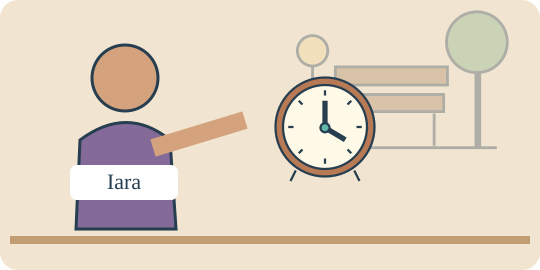

Observe quem aparece, o objeto e o lugar.

- Ana mostra o tempo.
- Iara mostra o tempo.
- Iara mostra o dado.

Minha resposta: __________________

### 90. Qual frase combina com a cena?

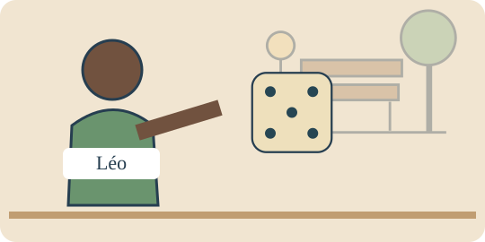

Observe quem aparece, o objeto e o lugar.

- Léo mostra o dado.
- Léo mostra o número.
- Ravi mostra o dado.

Minha resposta: __________________

### 91. Qual frase combina com a cena?

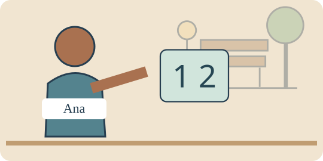

Observe quem aparece, o objeto e o lugar.

- Ana mostra o mapa.
- Eva mostra o número.
- Ana mostra o número.

Minha resposta: __________________

### 92. Qual frase combina com a cena?

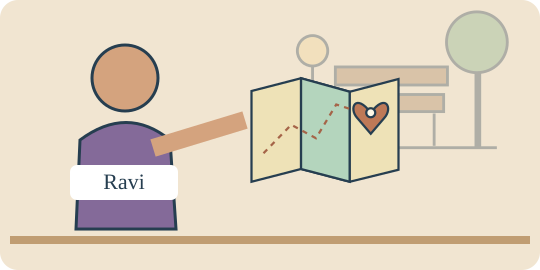

Observe quem aparece, o objeto e o lugar.

- Noa mostra o mapa.
- Ravi mostra o mapa.
- Ravi mostra o papel.

Minha resposta: __________________

### 93. Qual frase combina com a cena?

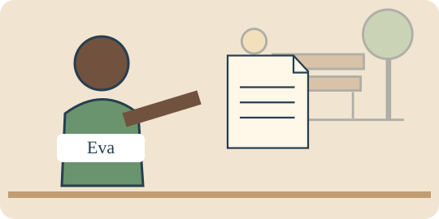

Observe quem aparece, o objeto e o lugar.

- Eva mostra o papel.
- Eva mostra a ficha.
- Luz mostra o papel.

Minha resposta: __________________

### 94. Qual frase combina com a cena?

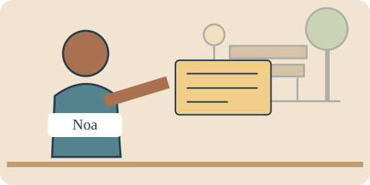

Observe quem aparece, o objeto e o lugar.

- Noa mostra a agenda.
- Luísa mostra a ficha.
- Noa mostra a ficha.

Minha resposta: __________________

### 95. Qual frase combina com a cena?

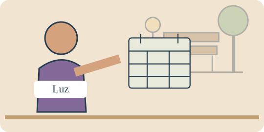

Observe quem aparece, o objeto e o lugar.

- Lia mostra a agenda.
- Luz mostra a agenda.
- Luz mostra a bolsa.

Minha resposta: __________________

### 96. Qual frase combina com a cena?

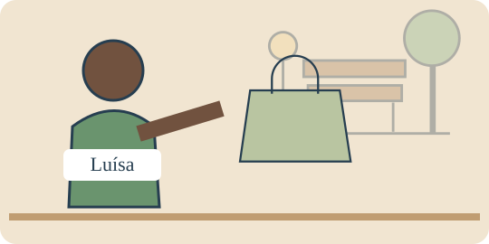

Observe quem aparece, o objeto e o lugar.

- Luísa mostra a bolsa.
- Luísa mostra a tabela.
- Caio mostra a bolsa.

Minha resposta: __________________

